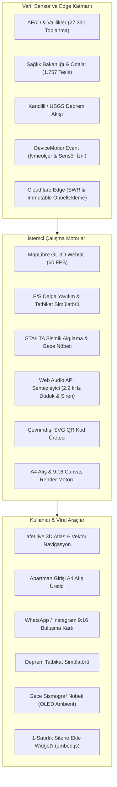

<p align="center">
  
</p>

# afet.live (V2) — Türkiye 3D Afet, Deprem Erken Uyarı ve Toplanma Atlası 🇹🇷

<p align="center">
  <strong>Yeni Nesil Sismik Erken Uyarı, 3B Tatbikat Simülatörü, Apartman Afişi Üretici, Aile Buluşma Kartı, Gece Nöbeti ve Sıfır-Çökme (Zero-Downtime Edge) Çevrimdışı Afet Platformu</strong>
</p>

<p align="center">
  <a href="https://afet.live"></a>
  <a href="LICENSE"></a>
  
  
  
  
  
  
  
</p>

---

## 📌 Vizyon ve Mimari Yaklaşım

**afet.live**, deprem kuşağında yer alan Türkiye genelinde kamu yararına tasarlanmış, sıfır sunucu bağımlılığıyla (%100 çevrimdışı çalışabilen) çalışan bir sismik güvenlik, erken uyarı, toplanma ve aile hazırlık atlasıdır.

Geleneksel afet uygulamaları, büyük depremlerde hücresel baz istasyonlarının çökmesi ve elektrik kesintileri yaşandığında işlevsiz kalmaktadır. **afet.live (V2 + Viral)**, cihaz üzerinde doğrudan çalışan fizik modelleri, donanım ivmeölçeri tabanlı sismik algılama, Cloudflare Edge önbellekleme zırhı ve önbelleklenmiş doğrulanmış GIS verileriyle şebeke tamamen kopsa veya milyonlarca anlık ziyaretçi gelse dahi hayat kurtarmaya devam eder.

---

## ⚡ V2 + Viral Büyüme Yetenekleri

### 1. 🌋 "Deprem Tatbikat & Dalga Zaman Makinesi" Simülasyon Modu
- **Hazır Tarihsel & Senaryo Depremleri:**
  - **Marmara 7.2 Senaryosu:** Kumburgaz / Silivri Fayı açıkları ($M_w 7.2$, Derinlik 10 km).
  - **İzmir Körfezi 6.8 Senaryosu:** İzmir Fayı açıkları ($M_w 6.8$, Derinlik 8 km).
  - **Kahramanmaraş 7.8 Tarihsel Simülasyonu:** 6 Şubat 2023 Pazarcık kırılması ($M_w 7.8$, Derinlik 8.6 km).
  - **Haritada Seçtiğim Noktada Test:** Harita üzerinde herhangi bir noktaya tıklayarak özel test depremi simülasyonu.
- **Canlı Dalga Cephesi Animasyonu:**
  - $V_p \approx 6.5\text{ km/sn}$ hızla yayılan mavi/cyan P-Dalgası halkası.
  - $V_s \approx 3.8\text{ km/sn}$ hızla yayılan kırmızı yıkıcı S-Dalgası cephesi.
- **Kişiselleştirilmiş Geri Sayım:** Kullanıcının kilitli GPS konumuna P ve S dalgalarının varışına kaç saniye kaldığını canlı gösterir ("Yıkıcı S-Dalgası Vuruşuna: 14 sn").
- **Canlı Kaçış Rotası:** Kullanıcının bulunduğu noktadan en yakın resmi AFAD toplanma alanına kaçış rotasını eş zamanlı çizer.
- **Medya & Eğitim Uyumluluğu:** Ekran kaydı alan yayıncılar ve öğretmenler için üstte belirgin `⚠️ TATBİKAT SİMÜLASYONU (GERÇEK DEPREM DEĞİLDİR)` güvenlik bandı yer alır.

---

### 2. 🖨️ "Apartman Girişi ve Asansör Acil Durum Afişi" (A4 Yazdır / PNG İndir)
- **Apartman ve Site Panosu Şablonu:** Bina yöneticilerinin ve komşuların tek tıkla hazırlayıp asansör yanına veya bina girişine asabileceği resmi bilgilendirme afişi.
- **Otomatik Konumsal Derleme:**
  - En yakın 3 resmi AFAD toplanma alanı (ad, mesafe, yürüyüş süresi, AFAD tescil rozeti).
  - En yakın 7/24 Acil Servis Hastanesi.
  - En yakın Nöbetçi / Acil Eczane (telefon ve adres bilgisiyle).
  - O konuma özel dinamik afet.live QR kodu (`https://afet.live/?lat=...&lng=...&zoom=16`).
  - Deprem anı ve hemen sonrasında yapılacak 4 altın kural (Çök-Kapan-Tutun, Vanaları kapat, Asansör kullanma, Toplanma alanına intikal et).
- **Yazdırma ve İndirme Seçenekleri:**
  - `window.print()` ile doğrudan A4 sayfasına (%100 uyumlu, mürekkep dostu temiz beyaz zemin) basım.
  - `<canvas>` ile yüksek çözünürlüklü A4 PNG olarak anında indirme.

---

### 3. 📱 WhatsApp & Instagram Hikaye (9:16) "Ailem İçin Afet Buluşma Kartı"
- **Sosyal Medya & Aile Grubu Formatı:** 1080x1920 dikey çözünürlükte, modern karanlık mod tasarımlı infografik kart üretir.
- **İçerik:**
  - Aile Soyadı / Başlığı ("Örn: YILMAZ AİLESİ AFET BULUŞMA PLANI").
  - ⭐ 1. Birincil Toplanma Alanı (adı, konumu, metre mesafesi, yürüyüş dakikası).
  - 🔄 2. Yedek Toplanma Alanı.
  - 🏥 En Yakın 7/24 Acil Servis Hastanesi.
  - 📞 Şehir Dışı İrtibat Kişisi Protokolü ve acil numaralar (112, 122).
  - afet.live dinamik QR kodu.
- **Tek Dokunuşla Paylaşım:** Mobil cihazlarda `navigator.share({ files: [blob] })` ile doğrudan WhatsApp Aile Grubuna veya Instagram Story'ye gönderilebilir. Desteklenmeyen masaüstü tarayıcılarda PNG olarak indirilir.

---

### 4. 🌙 Gece Sismograf Nöbeti & Ekran WakeLock
- **Başucu Nöbetçisi:** Telefon şarja takılıp düz zemine bırakıldığında `Screen Wake Lock API` ile ekranın kapanmasını engeller; sekme değişip geri dönüldüğünde kilidi otomatik olarak yeniden kazanır.
- **iOS Safari Sensör İzni Çözümü:** Kullanıcı dokunuşu anında resmi `DeviceMotionEvent.requestPermission()` iznini ve ses kilidini (`AudioContext unlock`) açarak gece saatler sonra bile dokunuşsuz tam sesli alarm çalabilmesini garanti eder.
- **OLED Saf Siyah HUD (#000000):** Ekran piksellerini kapatarak pil tüketimini ve göz yorgunluğunu sıfıra indirir; ekranda yalnızca sönük bir saat, canlı STA/LTA sismik dalgası ve ekran yanmasını (burn-in) önleyen periyodik mikro kaydırma çalışır.
- **Sürekli Sarsıntı & Erken Uyarı Tetikleyicisi:** Komodine çarpma gibi anlık dokunuşları filtreleyen 700 ms süreli STA/LTA doğrulaması veya ağdan gelen sismik erken uyarı durumunda ekranı tam parlaklıkta kırmızı/beyaz flaşöre geçirir ve kesintisiz 2.9 kHz sireni ateşler.

---

### 5. 🏢 Bina ve Zemin Sismik Ön Değerlendirme Kartı
- **4 Hızlı Tek Dokunuşlu Seçici:** Yapım Yılı (1999 Öncesi / 2000-2018 / 2018 Sonrası), Kat Sayısı, Zemin Kat Durumu (Normal / Yumuşak Kat & Dükkan) ve Bina Nizamı (Ayrık / Bitişik Çekiçleme Riski).
- **MTA Diri Fay Mesafesi & Yer İvmesi (PGA) Analizi:** Kullanıcının kilitli GPS konumu ile en yakın diri fay hattı mesafesini otomatik hesaplar; beklenen yer ivmesi aralığını ($g$) ve öncelik derecesini sunar.
- **Tek Tıkla Paylaşım:** En yakın acil toplanma alanının adı ve yürüyüş mesafesiyle birlikte sosyal medyada veya panoda paylaşılabilir görsel özet kartı üretir (`navigator.share` / Panoya Kopyala).

---

### 6. 🌐 1-Satırlık Sitene / Belediyene / Okuluna Ekle Widget'ı (`embed.js`)

Herhangi bir web sitesinin, apartman yönetiminin, belediyenin veya üniversite kulübünün kendi sitesine ekleyebileceği hafif (< 10 KB) ve stil çakışması yapmayan Shadow DOM Web Component widget'ı:

```html
<!-- Kendi sitenize veya portalınıza ekleyin -->
<script src="https://afet.live/embed.js" data-il="istanbul" data-ilce="kadikoy" async></script>
```

Özellikler:
- Sayfadaki diğer CSS stillerinden etkilenmeyen Shadow DOM mimarisi.
- Seçilen il ve ilçedeki canlı sismik durumu ve 27.331 doğrulanmış AFAD toplanma alanını gösterir.
- "En Yakın Toplanma Alanını Bul" butonu ile ziyaretçileri doğrudan ilgili ilçenin koordinatlarına yönlendirir.

---

### 7. 📍 Kitle Kaynaklı Doğrulama (GitHub Issue Forms)
- **Topluluk Doğrulaması:** Haritadaki her toplanma alanı ve sağlık tesisi detayında yer alan `"📍 Bu Noktayı Doğrula / Hata Bildir (GitHub)"` butonu ile vatandaşlar sahada gördükleri durumu resmi GitHub form şablonu üzerinden anında bildirebilir.
- **Otomatik Ön Doldurma:** Tıklandığında noktanın ID'si, koordinatları ve adı hazır doldurulmuş olarak GitHub Issue oluşturma ekranına yönlendirilir.
- **Şablon:** `.github/ISSUE_TEMPLATE/verify-point.yml`.

---

### 8. 🛡️ Cloudflare Zero-Downtime Edge Zırhı
- **Statik Edge Önbellekleme (`public/_headers`):**
  - GIS veri katmanları (`/data/*`, `*.geojson`, `*.pmtiles`) için `Cache-Control: public, max-age=3600, s-maxage=86400, stale-while-revalidate=604800`.
  - Derlenmiş varlıklar (`/assets/*`, `*.woff2`) için `Cache-Control: public, max-age=31536000, immutable`.
  - HTML kabuğu için `Cache-Control: public, max-age=0, s-maxage=60, stale-while-revalidate=86400`.
  - Yoğun deprem anında yüz binlerce anlık istek köken sunucuya ulaşmadan doğrudan Cloudflare Edge RAM'inden servis edilir.
- **Kanonik Yönlendirmeler & Kısa Bağlantılar (`public/_redirects`):**
  - `/tatbikat` → `/?mod=tatbikat`
  - `/afis` → `/?mod=afis`
  - `/kart` → `/?mod=kart`
  - `/nobet` → `/?mod=gece-nobeti`
  - `/bina` → `/?mod=bina-risk`
  - `/qr` → `/?mod=qr`
  - `/duduk` → `/?mod=duduk`
  - `/sismograf` → `/?mod=sismograf`

---

## 🗺️ %100 Doğrulanmış Coğrafi Bilgi (GIS) Veri Seti

Atlas bünyesindeki hiçbir veri yapay zeka tarafından tahmin edilmemiş veya rastgele serpiştirilmemiştir:

| Kategori | Doğrulanmış Nokta Sayısı | Veri Kaynağı & Hassasiyet |
| :--- | :--- | :--- |
| **Afet Toplanma Alanları** | **27.331 Adet** | AFAD Açık Veri Portalı & 81 İl Valiliği Envanteri (Poligon Centroid GPS) |
| **Acil Servis Hastaneleri** | **1.226 Adet** | Sağlık Bakanlığı HealthTurkiye & İl Altyapı Envanteri (Bina Giriş GPS) |
| **7/24 Nöbetçi Eczaneler** | **531 Adet** | İl Eczacı Odaları Resmi Nöbet Listesi (Kapı Numaralı Kesin GPS) |
| **Diri Fay Hatları** | **45+ Fay Zonu** | MTA Türkiye Diri Fay Haritası (Marmara, KAF, DAF, BAF) |

---

## 🏗️ Sistem Mimarisi



---

## 💻 Kurulum ve Geliştirme

### Gereksinimler
- Node.js 20.x veya üzeri (Önerilen: Node 22 LTS)
- npm 10.x veya üzeri

### Geliştirme Ortamı

```bash
# 1. Depoyu klonlayın
git clone https://github.com/himmetaga/turkiye-afet-haritasi.git
cd turkiye-afet-haritasi

# 2. Bağımlılıkları yükleyin
npm install

# 3. Güncel doğrulanmış GIS ve nöbetçi eczane verilerini derleyin
npm run fetch:data

# 4. Geliştirme sunucusunu başlatın
npm run dev
```

Uygulama `http://localhost:5173` adresinde sıcak yeniden yükleme (HMR) ile yayına başlar.

### Üretim Paketi Derleme

```bash
npm run build
npm run preview
```

---

## 🔒 Güvenlik ve Gizlilik
- Kullanıcı konumu tamamen cihaz üzerinde istemci tarafında işlenir; hiçbir kişisel konum verisi harici bir sunucuya kaydedilmez.
- Web Audio API ses osilatörleri yerel olarak üretilir; bant genişliği tüketmez ve çevrimdışı çalışır.
- Service Worker mimarisi tüm harita karolarını yerel IndexedDB'ye önbelleğe alır.
- Cloudflare Edge başlıkları donanım ivmeölçer, jiroskop ve konum izinlerini yalnızca birinci taraf origin ile sınırlar.

---

## 📄 Lisans
Bu proje [MIT Lisansı](LICENSE) kapsamında açık kaynak olarak kamu yararına geliştirilmektedir.
