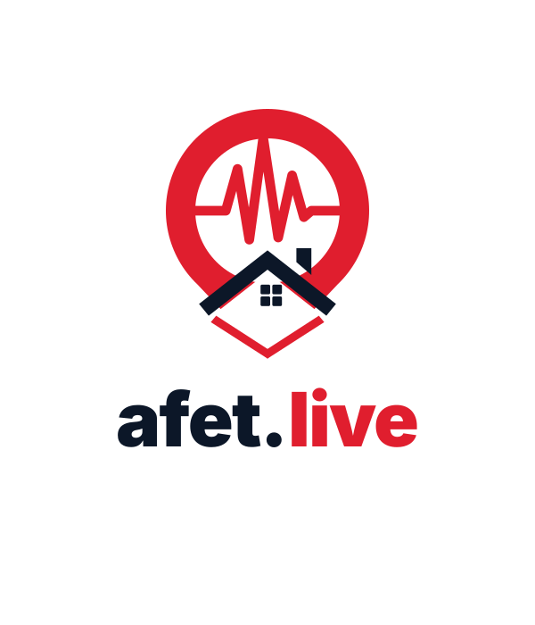
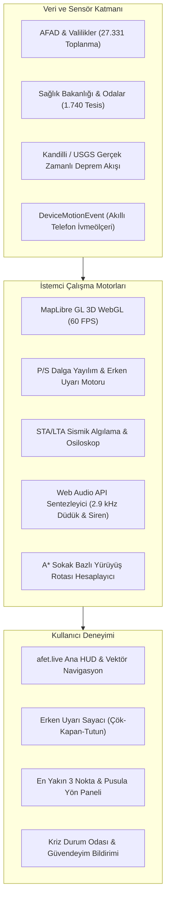

<p align="center">
  
</p>

# afet.live — Türkiye 3D Afet, Deprem Erken Uyarı ve Toplanma Atlası 🇹🇷

<p align="center">
  <strong>Yeni Nesil Sismik Erken Uyarı, Kitle Kaynaklı Sensör Düğümü ve Çevrimdışı Afet Koordinasyon Platformu</strong>
</p>

<p align="center">
  <a href="https://afet.live"></a>
  <a href="LICENSE"></a>
  
  
  
</p>

---

## 📌 Vizyon ve Mimari Yaklaşım

**afet.live**, deprem kuşağında yer alan Türkiye genelinde kamu yararına tasarlanmış, sıfır sunucu bağımlılığıyla (%100 çevrimdışı çalışabilen) çalışan bir sismik güvenlik, erken uyarı ve toplanma atlasıdır.

Geleneksel afet uygulamaları, büyük depremlerde hücresel baz istasyonlarının çökmesi ve elektrik kesintileri yaşandığında işlevsiz kalmaktadır. **afet.live**, cihaz üzerinde doğrudan çalışan fizik modelleri, donanım ivmeölçeri tabanlı sismik algılama ve önbelleklenmiş doğrulanmış GIS verileriyle şebeke tamamen kopsa dahi hayat kurtarmaya devam eder.

---

## ⚡ Temel Yetenekler & Sismik Güvenlik Mimarisi

### 1. 🚨 Fizik Tabanlı Sismik Erken Uyarı ve Dalga Yayılım Motoru
- **P-Dalgası (Öncül Sıkışma Dalgası):** $V_p \approx 6.5\text{ km/sn}$ hızla ilerleyen öncül dalganın varış süresi hesaplanır.
- **S-Dalgası (Yıkıcı Kayma Dalgası):** $V_s \approx 3.8\text{ km/sn}$ hızla ilerleyen asıl yıkıcı yüzey ve kayma dalgaları için kullanıcı konumuna özel milisaniyelik geri sayım sayacı çalışır.
- **Dinamik 3B WebGL Dalga Halkaları:** Deprem merkez üssünden başlayarak dışa doğru fiziksel hızda genişleyen çift fazlı dalga cephesi harita üzerinde canlı animasyonla gösterilir.
- **Otomatik Erken Uyarı Sireni:** Web Audio API ile harici ses dosyası gerektirmeden üretilen frekans taramalı acil durum alarmı ve geri sayım sesleri.

### 2. 🎯 Tek Odaklı Sismik Gösterge Mimarisi
- Haritada gerçekleşen tüm geçmiş depremler aynı anda yanıp sönerek haritayı karmaşıklaştırmaz.
- Yalnızca **en son gerçekleşen deprem** (`earthquakes[0]`) harita üzerinde dinamik sismik şok dalgasıyla (`seismic-ring`) nabız gibi atar; önceki depremler haritada kalabalık yapmayan sakin ve statik göstergelerle sunulur.

### 3. 🔒 Kilitli ve Kesin Konumlandırma (GPS & Network Lock)
- Kullanıcı konumu yalnızca donanım GPS uydusundan veya doğrulanmış ağ sinyalinden kilitlenir.
- Harita üzerinde dolaşırken, fayları incelerken veya binalara dokunurken kullanıcının gerçek konumu **asla değişmez ve üzerine yazılamaz**. Kullanıcı daima gerçek konumundan en yakın toplanma alanına olan rotasını görür.

### 4. 📈 Akıllı Cihaz İvmeölçer Sensör Düğümü (STA/LTA)
- Akıllı telefon ve dizüstü bilgisayarların dahili hareket sensörlerini (`DeviceMotionEvent` / Web Sensor API) kullanarak cihazı mikro bir sismografa dönüştürür.
- **STA/LTA Algoritması:** Kısa Süreli Ortalama ($STA \approx 0.4\text{ sn}$) ve Uzun Süreli Ortalama ($LTA \approx 8.0\text{ sn}$) enerji oranını ($R = STA / LTA$) gerçek zamanlı hesaplayarak ortam gürültüsünü filtreler ve ani sismik hareketleri tespit eder.
- **60 FPS Canlı Osiloskop:** Cihaz üzerindeki 3 eksenli $(X, Y, Z)$ ivme vektörlerini canlı dalga formu olarak çizer.

### 5. 📢 2.9 kHz Akustik Rezonans Afet Düdüğü & Optik Kurtarma Flaşörü
- Arama-kurtarma ekiplerinin betonarme molozların altından en yüksek verimle duyabildiği **2.900 Hz akustik rezonans frekansında** kesintisiz düdük sesi üretir.
- **Mors Kodu S.O.S (... --- ...):** Uluslararası acil yardım çağrısını döngüsel olarak çalar.
- **Strobe Flaşör:** Tozlu ve karanlık enkaz ortamlarında kurtarma ekiplerinin optik tespit yapabilmesi için yüksek kontrastlı beyaz-kırmızı ekran flaşörü sağlar.

### 6. 💬 P2P Kriz Durum Odası & "Güvendeyim" Ağı
- Bölge bazlı kriz bilgi paylaşımı ve durum takibi.
- Tek dokunuşla pil yüzdesi ve GPS koordinatı içeren **"Güvendeyim"** veya **"Acil Yardım Gerekli"** çağrısı oluşturma.

### 7. 🔍 Anlık Akıllı Arama & Tek Dokunuşla Rota Odaklanması
- Arama çubuğuna yazılan ilk 2 harften itibaren 27.331 toplanma alanı ve 1.740 sağlık kuruluşu taranır.
- Kullanıcının kilitli GPS konumuna olan gerçek mesafelerine göre sıralanarak açılır öneri panelinde sunulur.
- İlgili toplanma alanına veya hastaneye dokunulduğunda harita otomatik olarak odaklanır ve canlı sokak yürüyüş rotasını çizer.

---

## 🗺️ %100 Doğrulanmış Coğrafi Bilgi (GIS) Veri Seti

Atlas bünyesindeki hiçbir veri yapay zeka tarafından tahmin edilmemiş veya rastgele serpiştirilmemiştir:

| Kategori | Doğrulanmış Nokta Sayısı | Veri Kaynağı & Hassasiyet |
| :--- | :--- | :--- |
| **Afet Toplanma Alanları** | **27.331 Adet** | AFAD Açık Veri Portalı & 81 İl Valiliği Envanteri (Poligon Centroid GPS) |
| **Acil Servis Hastaneleri** | **1.226 Adet** | Sağlık Bakanlığı HealthTurkiye & İl Altyapı Envanteri (Bina Giriş GPS) |
| **7/24 Nöbetçi Eczaneler** | **514 Adet** | İl Eczacı Odaları Resmi Nöbet Listesi (Kapı Numaralı Kesin GPS) |
| **Diri Fay Hatları** | **45+ Fay Zonu** | MTA Türkiye Diri Fay Haritası (Marmara, KAF, DAF, BAF) |

> **Nöbetçi Eczane Kuralı:** Hafta içi 19:00'dan sonra ve pazar günleri boyunca harita otomatik olarak gündüz eczanelerini gizler; sadece 7/24 hizmet veren nöbetçi eczaneleri ve yürüyüş rotalarını gösterir.

---

## 🏗️ Sistem Mimarisi



---

## 💻 Kurulum ve Geliştirme

### Gereksinimler
- Node.js 20.x veya üzeri
- npm 10.x veya üzeri

### Geliştirme Ortamı

```bash
# 1. Depoyu klonlayın
git clone https://github.com/himmetaga/turkiye-afet-haritasi.git
cd turkiye-afet-haritasi

# 2. Bağımlılıkları yükleyin
npm install

# 3. Güncel doğrulanmış GIS ve nöbetçi eczane verilerini çekin
npm run fetch:data

# 4. Geliştirme sunucusunu başlatın
npm run dev
```

Uygulama `http://localhost:5173` adresinde sıcak yeniden yükleme (HMR) ile yayına başlar.

### Üretim Paketi Derleme

```bash
npm run build
npm run preview
```

---

## 🔒 Güvenlik ve Gizlilik
- Kullanıcı konumu tamamen cihaz üzerinde istemci tarafında işlenir; hiçbir kişisel konum verisi harici bir sunucuya kaydedilmez.
- Web Audio API ses osilatörleri yerel olarak üretilir; bant genişliği tüketmez ve çevrimdışı çalışır.
- Service Worker mimarisi tüm harita karolarını yerel IndexedDB'ye önbelleğe alır.

---

## 📄 Lisans
Bu proje [MIT Lisansı](LICENSE) kapsamında açık kaynak olarak kamu yararına geliştirilmektedir.
