# afet.live — Türkiye Afet, Deprem ve Acil Durum Atlası
### Turkey Disaster Resilience, Earthquake & Emergency Survival Atlas

[](LICENSE)
[](https://afet.live)
[](https://www.typescriptlang.org/)
[](https://vitejs.dev/)
[](https://afet.live)

🌐 **Canlı Uygulama / Live Site:** [https://afet.live](https://afet.live)

---

## 📌 Dil Seçimi / Language Selection
- [🇹🇷 Türkçe Dokümantasyon](#-türkçe-afetlive--türkiye-afet-ve-acil-durum-atlası)
  - [1. Genel Bakış ve Misyon](#1-genel-bakış-ve-misyon)
  - [2. Sistem ve Yazılım Mimarisi](#2-sistem-ve-yazılım-mimarisi)
  - [3. Faydaya Göre Modül Kataloğu (27 Araç)](#3-faydaya-göre-modül-kataloğu-27-araç)
  - [4. Veri Kaynakları & Doğruluk](#4-veri-kaynakları--doğruluk)
  - [5. Gizlilik & Sıfır Veri Kaybı (Zero-Data-Retention)](#5-gizlilik--sıfır-veri-kaybı-zero-data-retention)
  - [6. Kurulum ve Yerel Çalıştırma](#6-kurulum-ve-yerel-çalıştırma)
- [🇬🇧 English Documentation](#-english-afetlive--turkiye-disaster-resilience-and-emergency-atlas)
  - [1. Overview & Core Mission](#1-overview--core-mission)
  - [2. System Architecture](#2-system-architecture)
  - [3. Feature Catalog by Utility (27 Modules)](#3-feature-catalog-by-utility-27-modules)
  - [4. Telemetry & Data Sources](#4-telemetry--data-sources)
  - [5. Privacy & Zero Tracking Architecture](#5-privacy--zero-tracking-architecture)
  - [6. Installation & Local Development](#6-installation--local-development)

---

# 🇹🇷 Türkçe: afet.live — Türkiye Afet ve Acil Durum Atlası

## 1. Genel Bakış ve Misyon

**afet.live**, Türkiye ve komşu coğrafyalarda meydana gelebilecek deprem, sel, heyelan, orman yangını, bina çökmesi ve tsunami gibi afet anlarında ve sonrasında sivil halkın, arama kurtarma gönüllülerinin ve sahra ekiplerinin hayatta kalmasını desteklemek amacıyla geliştirilmiş **açık kaynaklı, bağımsız ve çevrimdışı (offline-first)** bir sivil afet atlasıdır.

6 Şubat 2023 Kahramanmaraş depremleri ve geçmiş Marmara afetleri göstermiştir ki; afet anında hücresel baz istasyonları dakikalar içinde kilitlenmekte, merkezi sunucular çökmekte, internet erişimi kesilmekte ve elektrik şebekesi devre dışı kalmaktadır.

Bu hayati gereksinim doğrultusunda **afet.live**, **"Sıfır Sunucu Bağımlılığı (Zero Server Dependency)"** ilkesiyle tasarlanmıştır:
- Uygulama tarayıcıya veya telefona bir kez yüklendiğinde (PWA), hücresel veri, fiber internet ve Wi-Fi tamamen kopsa dahi **27.331 resmi AFAD toplanma alanı, 1.226 acil servis hastanesi, MTA diri fay haritası ve tüm hayatta kalma araçları %100 çevrimdışı çalışmaya devam eder.**
- Kullanıcının GPS konumu, kimliği veya tıbbi verileri asla harici bir sunucuya kaydedilmez; tüm hesaplamalar (Haversine mesafe, açı, triyaj, klorlama dozajı) doğrudan kullanıcının cihaz işlemcisinde yerel olarak gerçekleştirilir.

---

## 2. Sistem ve Yazılım Mimarisi

afet.live mimarisi, yüksek performans, ultra düşük pil tüketimi ve kesintisiz çevrimdışı güvenilirlik sağlamak üzere 4 ana katmandan oluşur:

```mermaid
graph TD
    subgraph Presentation ["1. Sunum & Arayüz Katmanı (UI/UX)"]
        A[HeaderHUD & Fayda Odaklı 4 Kategorili Menü]
        B[Sabit BitChat Kriz FAB Butonu]
        C[3B Vektör Harita Motoru - MapLibre GL]
        D[NearestPointsHUD - En Yakın Noktalar]
        E[21 Modüler Afet Modalı & HUD]
    end

    subgraph StateAndCompute ["2. Durum, Hesaplama & Algoritma Katmanı"]
        F[GeoMath: Haversine & Rota Yönü]
        G[Sismik STA/LTA Algoritması - 100Hz İvmeölçer]
        H[Erken Uyarı: P & S Dalga Yayılım Modeli]
        I[START Sahra Triyaj Karar Ağacı]
        J[Web Audio API DSP: 2.9kHz / 3.5kHz / 18.5kHz]
        K[Su Dezenfeksiyon & Klorlama Hesaplayıcı]
    end

    subgraph OfflineAndP2P ["3. Çevrimdışı & Dağıtık Ağ Katmanı (P2P Mesh)"]
        L[Service Worker & CacheStorage - Workbox PWA]
        M[Nostr Protocol: wss://relay.damus.io - wss://nos.lol]
        N[WebRTC DataChannel: Tarayıcılar Arası Doğrudan Veri]
        O[BroadcastChannel: Sekmeler Arası Yerel Veri Yolu]
        P[İnternetsiz Hava Boşluğu QR Kod Paketi]
    end

    subgraph CivicTelemetry ["4. Kamu Açık Veri & Telemetri Katmanı"]
        Q[AFAD 81 İl Toplanma Alanları - 27.331 Saha]
        R[MTA Türkiye Diri Fay Hatları Veritabanı]
        S[Kandilli Rasathanesi & AFAD Canlı Deprem Akışı]
        T[Sağlık Bakanlığı Acil Servisleri - 1.226 Hastane]
        U[Günlük Canlı Nöbetçi Eczaneler]
        V[GloFAS Nehir Debisi & Yağış Radarı - ECMWF]
        W[Open-Meteo AQI, Asbest ve Zehirli Gaz Radarı]
        X[Türk Kızılay 22 Bölge Kan Merkezi & Donör Matrisi]
        Y[TRAC & PMR 446 Acil Telsiz Frekans Kataloğu]
    end

    Presentation --> StateAndCompute
    StateAndCompute --> OfflineAndP2P
    OfflineAndP2P --> CivicTelemetry
```



### Temel Mimari Prensipleri:
1. **Zero-Lag & GPU-Accelerated Rendering:** Harita motoru 60 FPS WebGL ile çalışır; 27 binden fazla nokta kümeleme (clustering) ve ekran dışı culling algoritmalarıyla düşük donanımlı telefonları dahi kastırmadan akıcı çalışır.
2. **AudioWorklet / Web Audio DSP:** Afet düdüğü basit bir ses dosyası oynatmaz; tarayıcının Web Audio API osilatörleri üzerinden insan kulağının en duyarlı olduğu 2.9 kHz frekansını matematiksel olarak sentezler ve ekran kilitlendiğinde dahi çalmaya devam eder.
3. **Decentralized Nostr & WebRTC Mesh:** Hücresel operatör kuleleri çöktüğünde veya bant daraltması uygulandığında, BitChat protokolü sansürlenemeyen açık Nostr röleleri üzerinden şifreli afet mesajlaşması sağlar; internet tamamen kesildiğinde ise telefonlar arasında QR kod tabanlı hava boşluğu (air-gapped) veri alışverişine geçer.

---

## 3. Faydaya Göre Modül Kataloğu (24 Araç)

afet.live menüsü, afet esnasında kafa karışıklığını önlemek amacıyla **faydasına göre 4 ana kategoride** düzenlenmiştir. Ana ekranda ise yalnızca en kritik aksiyonlar (**AFET DÜDÜĞÜ & S.O.S**, **BitChat Kriz Butonu** ve **En Yakın Güvenlik Segmentleri**) yer alır:

### 🚨 Kategori 1: Acil Müdahale & S.O.S
1. **Afet Düdüğü & Akustik Enkaz Sinyali (2.9 kHz + 3.5 kHz Geofon + 18.5 kHz K9 Arama Köpeği):**
   - **2.9 kHz SOS Düdüğü:** Beton ve moloz yığınlarını delip geçen, insan kulağının en hassas olduğu akustik frekansta aralıksız çalar.
   - **3.5 kHz Geofon Sonar Darbesi:** AFAD ve uluslararası INSARAG arama kurtarma ekiplerinin sismik dinleme mikrofonları için optimize edilmiş, her 15 saniyede 3 darbe ve titreşim yayan, cihaz pilini günlerce koruyan darbe modu.
   - **18.5 kHz K9 Arama Köpeği Çağrısı:** İnsan kulağını yormayan ancak enkaz köpeklerinin kilometrelerce uzaktan duyabildiği ultrasonik frekans.
   - **Kamera LED Flaşörü & Ekran Strobosu:** Gece arama kurtarma dronları ve termal kameralar için senkronize donanım flaşı.
   - **Screen WakeLock:** Telefon ekranının kilitlenmesini veya uyku moduna geçmesini engelleyerek kesintisiz sinyal yayar.
2. **Afet Triyaj Asistanı (START Sahra Protokolü):**
   - Uluslararası Simple Triage and Rapid Treatment (START) standardı.
   - 15 saniyelik solunum, kapiller geri dolum (dolaşım) ve bilinç kontrolleriyle kazazedeyi Kırmızı (Acil Turnike/Hava Yolu), Sarı (Gecikebilir), Yeşil (Hafif Yaralı) ve Siyah (Eks) olarak sınıflandırır.
   - Sahra müdahale talimatları üretir ve tek tıkla BitChat acil enkaz kanalına aktarır.
3. **Turnike Güvenlik Zamanlayıcısı (120 Dk Protokolü & Alın Damgası):**
   - Akut atardamar kanamalarında doku kangrenini ve uzuv kaybını önleyen kesin sahra kronometresi.
   - 45. ve 90. dakikalarda iskemi uyarısı ve sesli sinyal verir; 120. dakikada geri dönüşsüz hasar eşiğini bildirir.
   - Sağlık ekipleri için yüksek kontrastlı alın damgası formatı üretir (Örn: `T: 14:35 - SAĞ BACAK`).
4. **Tek Tuşla Acil Durum SMS & İhbar Hatları:**
   - 3G/4G/5G veri bağlantısı koptuğunda, 2G hücresel baz istasyonlarının sinyal kuyruğundan iletilebilen yüksek öncelikli SMS.
   - Kullanıcının kesin GPS koordinatlarını, Google Maps linkini ve durumunu içeren mesajı tek tuşla hazır SMS uygulamasına yükler.
   - 112 Acil Çağrı, 122 AFAD, 187 Doğalgaz Kaçağı ve 186 Elektrik Arıza hızlı arama butonlarını barındırır.
5. **BitChat Dağıtık P2P Afet Ağı & Nostr Kriz Odası:**
   - Merkezi sunucu, üyelik veya GSM numarası gerektirmez.
   - Açık Nostr röleleri (`wss://relay.damus.io`, `wss://nos.lol`) üzerinden merkeziyetsiz şifreli mesajlaşma.
   - WebRTC DataChannel ile telefondan telefona doğrudan P2P veri aktarımı.
   - **Acil Sıfırlama (Emergency Wipe):** Tehlike anında cihazdaki tüm mesaj ve kimlik verilerini tek tıkla kalıcı olarak siler.
   - **Ana Ekran Sabit FAB İkonu:** Ekranı kapatmadan canlı ağ/peer durumunu gösteren küçük, zarif yüzen buton.
6. **Afet Telsizi & Frekans Rehberi (TRAC & PMR 446):**
   - Baz istasyonları çöktüğünde kullanılan PMR 446 lisanssız el telsizi kanalları (Kanal 1 Genel Çağrı, Kanal 8 Arama Kurtarma).
   - TRAC (Türkiye Radyo Amatörleri Cemiyeti) 145.500 MHz VHF / 433.500 MHz UHF acil röle frekansları.
   - Hayati alt ton kapatma kuralı (CTCSS/DCS: 0) ve Web Audio telsiz bip / 1750 Hz röle ton testleri.
7. **Gece Sismograf Nöbeti & Başucu Deprem Alarmı:**
   - Telefon komodin veya zemin üzerine bırakıldığında cihaz ivmeölçerini 100 Hz frekansta dinler.
   - Eşik üstü sismik P dalgası algılandığında tam ses seviyesinde siren çalarak uykudaki kullanıcıyı uyandırır.
   - Ekranı uyanık tutan WakeLock entegrasyonu içerir.

---

### 📡 Kategori 2: Erken Uyarı & Çevre Radarları
8. **Canlı Sel & Taşkın Erken Uyarı Radarı (GloFAS & Open-Meteo):**
   - Kullanıcının koordinatına özel anlık yağış oranı ($mm/saat$) ve Avrupa Komisyonu GloFAS nehir debisi ($m^3/s$) analizleri.
   - 4 seviyeli taşkın risk indeksi (Normal, Dikkat, Yüksek, Kritik).
   - 15 cm (ayak bileği) ve 30 cm (araç sürükleme) kuralı, gizli rögar kapakları ve sel suyunda kaçak elektrik tehlike direktifleri.
9. **Enkaz Tozu, Yangın & Hava Kalitesi Radarı (Open-Meteo):**
   - Avrupa Çevre Ajansı (AQI) hava kalitesi indeksi, PM2.5 ince toz, PM10 kaba toz, Karbonmonoksit (CO), $NO_2$, $SO_2$ ve Ozon değerleri.
   - Enkaz yıkıntılarından kalkan asbest lifleri ve silika tozuna karşı N95/FFP2 maske hayati uyarısı.
   - Çadırlarda ve kapalı alanlarda çalıştırılan benzinli jeneratörlerin sebep olduğu zehirlenmelere karşı CO ikazı.
10. **Tsunami Erken Uyarı & Kıyı Tahliye Radarı (Marmara, Ege & Akdeniz):**
    - Kandilli Rasathanesi ve ODTÜ Kıyı ve Deniz Mühendisliği tsunami protokolleri.
    - Kıyı şeridinde deniz tabanı depremleri sonrası "Kıyıdan en az 500 metre iç kesime veya +15 metre yüksekliğe tırman" direktifi.
    - Deniz suyunun aniden çekilmesinin tsunami dalgasının ilk göstergesi olduğu hayati kaçış sinyali.
    - Kullanıcının konumuna göre en yakın yüksek kotlu AFAD toplanma alanına tek tıkla rota yönlendirmesi.
11. **Sismik Erken Uyarı & P/S Dalgası Simülasyonu:**
    - Birincil (P dalgası: $6-7\text{ km/s}$) ve ikincil yıkıcı (S dalgası: $3.5-4\text{ km/s}$) yayılım sürelerini anlık hesaplar.
    - Kullanıcının deprem merkez üssüne olan mesafesine göre yıkıcı sarsıntı gelmeden önceki kaçış ve hayat üçgeni kurma süresini (saniye cinsinden) gösterir.
12. **Kalibre Edilebilir Cihaz Sismografı (STA/LTA Algoritması):**
    - Akıllı telefonun dahili donanım jiroskop ve ivmeölçerini kullanarak mikrosarsıntıları analiz eder.
    - STA/LTA (Short-Term Average / Long-Term Average) sismolojik algoritmasıyla zemin gürültüsünü filtreler.
    - Gerçek zamanlı yerçekimi ivmesi ($m/s^2$ ve Gal birimi) ile Mercalli şiddet skalası tahminleri.
13. **Depremi Hissettim Bildirimi:**
    - USGS "Did You Feel It?" standartlarına uygun Mercalli I-X ölçeğinde sarsıntı geri bildirimi.
    - Sivil halkın hissettiği şiddeti doğrudan harita telemetrisine aktarma imkanı.

---

### 🎒 Kategori 3: Hazırlık & Aile Güvenliği
14. **Türk Kızılay Kan Bağış Merkezleri & Donör Eşleşme Portalı:**
    - Türkiye genelinde 22 doğrulanmış Kızılay Bölge Kan Merkezi (Marmara, Orta Anadolu, Ege, Doğu Anadolu, Güneydoğu vb.).
    - 8 kan grubu için interaktif verici-alıcı uyumluluk matrisi (0- evrensel verici, AB+ evrensel alıcı).
    - BitChat ağı üzerinden doğrulanmış acil kan ihtiyacı çağrısı yayımlama.
15. **Afet İlaç & Tedavi Pasaportu (Sahra Eşdeğer Etken Madde Rehberi):**
    - Deprem ve tahliye esnasında kaybolan kronik ilaçların sahra eczanelerinden temini için çevrimdışı reçete pasaportu.
    - Ticari marka (Beloc, Lantus, Ventolin vb.) arandığında eşdeğer etken maddeleri (*Metoprolol*, *İnsülin Glarjin*, *Salbutamol*) gösterir.
    - Elektriksiz ortamda insülin için Toprak Çömlek (Zeer Pot) buharlaşmalı soğuk zincir koruma rehberi içerir.
16. **Ev İçi Deprem Tehlike Avı (Yapısal Olmayan Risk Denetimi & Ev Puanı):**
    - Deprem yaralanmalarının %70'ini oluşturan mobilya devrilmelerine karşı oda bazlı interaktif denetim.
    - Gardırop, kombi, mutfak dolap mandalları ve kaçış koridoru denetlenerek %0-100 Ev Güvenlik Puanı (A-B-C-D Seviyesi) ve DIY sabitleme raporu üretir.
17. **Afet Sahra İhtiyaç & Yardım Masası (P2P Dağıtım & Çadırkent Koordinasyonu):**
    - Çadırkentlerde ve sahra bölgelerinde bebek maması, bez, kadın hijyen kiti, içme suyu, kışlık bot, uyku tulumu ve jeneratör gibi acil ihtiyaçları veya eldeki fazla malzemeyi kategorize eder.
    - GPS koordinatları ve çadır numarasıyla standart sahra yardım pusulası üretir; tek tıkla BitChat P2P ağına yayınlar veya SMS/WhatsApp için kopyalar.
18. **Pati & Evcil Hayvan Afet Güvenliği (Pati Pasaportu & HayTAP Tahliye Rehberi):**
    - Afet anında kedi, köpek ve can dostlarımız için 15 haneli mikroçip, sahip telefonu ve tıbbi notları içeren Dijital Pati Pasaportu ve Tasma Künyesi.
    - 7 günlük mama, katlanır su kabı, taşıma kafesi (box) ve hayvan ilk yardım kiti içeren Pati Afet Çantası kontrol listesi.
    - HayTAP ve AFAD onaylı enkaz altı hayvan kurtarma, kaçmayı önleyen tahliye protokolleri ve acil hayvan kurtarma ihbar hatları.
19. **72 Saatlik Afet Çantası & Eksik Malzeme Takibi:**
    - Su, gıda, ilk yardım, hijyen, araç-gereç ve resmi evrak kategorilerinde kişiselleştirilebilir kontrol listesi.
    - Eksik malzemeleri filtreleyip tek dokunuşla aile fertlerine SMS veya WhatsApp ile gönderebilme.
20. **Bina ve Zemin Sismik Ön Değerlendirme Kartı:**
    - Kullanıcının koordinatına en yakın MTA aktif diri fay hattının adı, mesafesi ve yıllık kayma hızı.
    - Bina yapım yılı (1999 öncesi / 2000-2018 / 2018 sonrası deprem yönetmelikleri) ve zemin sınıfı analizi.
21. **Kilit Ekranı Tıbbi Kimlik & Duvar Kağıdı (ICE):**
    - Telefon ekranı kilitli ve şifreliyken dahi arama kurtarma ekiplerinin görebileceği tıbbi duvar kağıdı oluşturur.
    - Kan grubu, kronik hastalıklar, alerjiler, acil aranacak kişi (ICE) numarası ve en yakın toplanma alanını şık bir görselde birleştirip telefon galerisine indirir.
22. **Deprem Tatbikat Simülatörü:**
    - P ve S dalgası siren sesleriyle desteklenen interaktif deprem tatbikatı.
    - Sarsıntı süresince Çök-Kapan-Tutun zamanlayıcısı ve sarsıntı bitiminde tahliye yönergeleri.
23. **Çevrimdışı QR Güvendeyim Durum Paketi:**
    - İnternet ve hücresel şebekenin tamamen çöktüğü durumlarda, cihazlar arasında hava boşluğu (air-gap) ile veri aktarımı.
    - Aile bireylerinin durumunu, koordinatlarını ve pil seviyesini QR kod taratarak kaydedebilme.

---

### 📋 Kategori 4: Bilgilendirme, Rehberler & Afişler
24. **Çadırkent Kış Isınma Güvenliği & Karbonmonoksit (CO) Zehirlenme Testi:**
    - Çadırkent ve konteynerlerde soba ve katalitik ısıtıcılardan kaynaklanan ölümcül karbonmonoksit gazına karşı interaktif 6 belirti risk testi.
    - Çadır kumaşı ve yataklardan 100 cm mesafe kuralı, sürekli 5 cm açık tepe havalandırma kuralı, uykuda soba söndürme kuralı ve çadır içinde jeneratör çalıştırmama direktifi.
    - Galvaniz baca geçiş sacı (flanş) standartları ve zehirlenmede açık havaya çıkarma ilk yardım adımları.
25. **Afet, Enkaz & İlkyardım Hayatta Kalma Rehberi:**
    - **Kapalı Alanda:** Merdiven tuzağı uyarısı (deprem anında merdivenlere koşmama kuralı), hayat üçgeni, şalter ve vanaların kapatılması.
    - **Enkaz Altında:** Oksijen koruma, 3 vuruş uluslararası akustik dinleme kodu ("TAK - TAK - TAK"), kesinlikle kibrit/çakmak yakmama kuralı (gaz patlaması önleme).
    - **Açık Alanda & Araçta:** Kontak anahtarını üzerinde bırakma kuralı (itfaiye ve ambulans geçişi için), cephe kaplamaları ve cam yağmurundan korunma.
    - **Sel & Yangın:** 30 cm sel suyu sürüklenme riski, yangında zemine paralel sürünme direktifi.
    - **İlk Yardım & Crush Sendromu:** Enkazdan çıkan kazazedeye damar yolu açılmadan önce kontrolsüz su vermeme kuralı (ani böbrek iflası ve potasyum zehirlenmesi önleme), turnike uygulama ve zaman kaydı.
    - **Temiz Su & Salgın Hastalık Önleme:** Şebeke sularını kaynatma protokolü, acil su klorlama formülü (1 litre berrak suya 3 damla, bulanık suya 5-6 damla kokusuz saf çamaşır suyu damlatıp 30 dk bekleme), sahra tuvaletlerinin su kaynaklarından 50 m uzağa kurulması, kireç dökme kuralı, kolera, tifo ve uyuz salgınlarına karşı korunma kuralları.
26. **Apartman Girişi & Asansör Acil Durum Afişi (A4 Formatı):**
    - Bina yöneticileri ve site sakinleri için tek tıkla binanın etrafındaki en yakın 3 AFAD toplanma alanını, acil servis hastanelerini ve nöbetçi eczaneleri harita kroki ve QR koduyla derleyen, doğrudan yazdırılabilir (Ctrl+P / PDF) A4 afişi.
27. **Aile Afet Buluşma Kartı (Story 9:16 Formatı):**
    - Aile bireyleriyle sosyal medyada (WhatsApp, Telegram, Instagram Story) paylaşılabilen, acil buluşma noktasını ve irtibat kişisini içeren görsel afet kartı üretici.

---

## 4. Veri Kaynakları & Doğruluk

afet.live üzerinde yer alan veriler kamuya açık resmi kurumsal veritabanlarından ve sivil açık veri portallarından derlenmektedir:

| Veri Seti | Sağlayıcı Kurum / Kaynak | Kapsam & Detay |
| :--- | :--- | :--- |
| **Afet Toplanma Alanları** | AFAD & e-Devlet Kapısı | Türkiye genelinde 81 il, 27.331 resmi toplanma alanı (su, elektrik, çadır sahası bilgileriyle) |
| **Diri Fay Hatları** | MTA (Maden Tetkik ve Arama Genel Müdürlüğü) | 1:25.000 ölçekli Türkiye Diri Fay Haritası vektör katmanı |
| **Canlı Son Depremler** | Boğaziçi Üniversitesi Kandilli Rasathanesi & AFAD | Anlık sismik titreşim akışı, derinlik, büyüklük ve merkez üssü |
| **Acil Servis Hastaneleri** | T.C. Sağlık Bakanlığı (HealthTurkiye) | 1.226 doğrulanmış kamu, üniversite ve özel acil servis hastanesi |
| **Nöbetçi Eczaneler** | İzmir BB Açık Veri Portalı & EczaneBul | Her gün saat 18:00'den ertesi gün 08:30'a kadar geçerli günlük canlı nöbetçi listeleri |
| **Kan Bağış Merkezleri** | Türk Kızılay Kan Hizmetleri Genel Müdürlüğü | 22 Bölge Kan Merkezi ve koordinatları |
| **Sel & Taşkın Radarı** | Avrupa Komisyonu ECMWF / GloFAS | Canlı nehir debisi ($m^3/s$) ve yağış erken uyarı modelleri |
| **Hava Kalitesi & Duman** | Open-Meteo & Avrupa Çevre Ajansı (Copernicus) | AQI, PM2.5, PM10, CO, asbest tozu ve duman konsantrasyonları |
| **Afet Telsiz Frekansları** | TRAC & BTK | PMR 446 Kanal 1-8 ve VHF/UHF amatör telsiz acil frekansları |

---

## 5. Gizlilik & Sıfır Veri Kaybı (Zero-Data-Retention)

- **Sıfır Sunucu Kaydı:** afet.live sunucularında hiçbir kullanıcı hesabı, telefon numarası, GPS konumu veya kriz mesajı saklanmaz.
- **Yerel Depolama:** Afet çantası, aile bilgileri ve ICE kilit ekranı verileri yalnızca kullanıcının telefonundaki `LocalStorage` ve `IndexedDB` belleğinde şifresiz tutulur ve üçüncü taraflarla paylaşılmaz.
- **Kriptografik Anahtar Üretimi:** BitChat kimliği her cihaz için yerel olarak rastgele bir Ed25519 / Nostr pubkey üretir; telefon şebekesi kopsa dahi anonimlik korunur.

---

## 6. Kurulum ve Yerel Çalıştırma

Projeyi kendi bilgisayarınızda yerel ortamda çalıştırmak için:

```bash
# 1. Repoyu klonlayın
git clone https://github.com/himmetaga/turkiye-afet-haritasi.git
cd turkiye-afet-haritasi

# 2. Bağımlılıkları yükleyin
npm install

# 3. Geliştirme sunucusunu başlatın
npm run dev
```

Tarayıcınızda `http://localhost:5173` adresine giderek uygulamayı görüntüleyebilirsiniz.

### Üretim Paketini Derleme
```bash
# Kamu verilerini güncelle ve üretim kodunu derle
npm run build

# Derlenen üretim paketini önizle
npm run preview
```

---

<br />

# 🇬🇧 English: afet.live — Turkiye Disaster Resilience and Emergency Atlas

## 1. Overview & Core Mission

**afet.live** is an open-source, civic-engineered, **offline-first disaster resilience and emergency survival platform** designed to provide instant, life-saving information during earthquakes, floods, landslides, wildfires, structural collapses, and tsunamis across Turkey and adjacent regions.

During major catastrophic events (such as the February 6, 2023 Kahramanmaraş earthquakes), cellular mobile networks fail within minutes due to congestion, physical mast damage, and power grid collapse.

To ensure uninterrupted availability when communication lines are dead, **afet.live is built on a "Zero-Server-Dependency" architecture**:
- Once cached or installed as a Progressive Web App (PWA), **all 27,331 official AFAD assembly points, 1,226 emergency hospitals, active fault lines, and critical survival tools function 100% offline.**
- All geospatial, proximity, bearing, triage, and water chlorination computations execute client-side on the user's hardware.
- No user location, personal data, or distress messages are tracked, stored, or sent to any central server.

---

## 2. System Architecture

The technical stack is engineered around low-latency performance, ultra-low battery consumption, and zero-network resilience:

```mermaid
graph TD
    subgraph UI ["1. Presentation Layer"]
        A[HeaderHUD & Categorized Menu Matrix]
        B[Floating BitChat Crisis Action Button]
        C[3D Vector Map Engine - MapLibre GL]
        D[NearestPointsHUD - Segmented Fast Access]
        E[21 Specialized Disaster Modals]
    end

    subgraph Logic ["2. State, Compute & Signal Processing Layer"]
        F[GeoMath: Haversine, Bearings & Street Proximity]
        G[STA/LTA Seismic Filter - 100Hz Accelerometer]
        H[Early Warning: Seismic P & S Wave Kinematics]
        I[START Protocol Triage Decision Tree]
        J[Web Audio API DSP: 2.9kHz / 3.5kHz / 18.5kHz]
        K[Water Chlorination Dosage Calculator]
    end

    subgraph Network ["3. Offline & Decentralized P2P Mesh Layer"]
        L[Workbox Service Worker & CacheStorage]
        M[Nostr Relays: wss://relay.damus.io - wss://nos.lol]
        N[WebRTC DataChannel: Browser-to-Browser Mesh]
        O[BroadcastChannel: Intra-Device Bus]
        P[Air-Gapped Offline QR Status Exchange]
    end

    subgraph Data ["4. Civic Telemetry & Open Data Layer"]
        Q[AFAD 81 Provinces Assembly Points - 27,331 Sites]
        R[MTA Active Geological Fault Lines DB]
        S[Kandilli Observatory & AFAD Live Quake Stream]
        T[Ministry of Health Certified Emergency ERs - 1,226]
        U[Live Daily On-Duty Pharmacies]
        V[GloFAS River Discharge & Flood Radar - ECMWF]
        W[Open-Meteo Air Quality, Asbestos & Smoke Radar]
        X[Turkish Red Crescent 22 Regional Blood Centers]
        Y[TRAC & PMR 446 Emergency Radio Catalog]
    end

    UI --> Logic
    Logic --> Network
    Network --> Data
```



---

## 3. Feature Catalog by Utility (24 Modules)

The toolset is organized into **4 logical categories based on immediate survival benefit**, while maintaining a clean, uncluttered main screen with primary quick actions:

### 🚨 Category 1: Emergency Response & S.O.S
1. **Disaster Whistle & Acoustic Sonar Pulses (2.9 kHz + 3.5 kHz Geophone + 18.5 kHz K9 Ultrasonic):**
   - **2.9 kHz Acoustic Whistle:** Synthesized at the human ear's peak resonance frequency to penetrate concrete and structural debris.
   - **3.5 kHz Geophone Sonar Pulse:** Optimized for AFAD and INSARAG seismic listening microphones; fires 3 rapid acoustic/vibrational pulses every 15 seconds to conserve battery life over days.
   - **18.5 kHz K9 Ultrasonic Hound Beacon:** Audible to rescue dogs at extreme distances while sparing human eardrums.
   - **Camera LED Flash & Strobe:** Synchronized visual pulsing for nighttime search drones and thermal imaging.
   - **Screen WakeLock:** Keeps the device awake and transmitting even when untouched.
2. **Disaster Field Triage Assistant (START Protocol):**
   - Implements the international Simple Triage and Rapid Treatment decision tree.
   - Evaluates respiration, capillary refill (perfusion), and mental status in under 15 seconds to categorize victims into Red (Immediate), Yellow (Delayed), Green (Minor), and Black (Deceased).
   - Generates instant emergency medical directives and broadcasts directly to the BitChat crisis network.
3. **Tourniquet Safety Timer & Forehead Stamp (120-Min Protocol):**
   - High-precision field timer preventing ischemic tissue necrosis and limb amputations from prolonged tourniquets.
   - Visual and audible alerts at 45 and 90 minutes; flags irreversible necrosis danger at 120 minutes.
   - Generates high-contrast digital stamps (e.g., `T: 14:35 - RIGHT LEG`) to mark victims for trauma surgeons.
4. **One-Tap Emergency SMS & Hotlines:**
   - Pre-formats high-priority SMS containing precision GPS coordinates and a map link, capable of routing through 2G signaling channels when data connections fail.
   - Direct dial shortcuts for 112 National Emergency, 122 AFAD, 187 Gas Leakage, and 186 Electric Grid Failure.
5. **BitChat Decentralized P2P Mesh & Nostr Crisis Room:**
   - Serverless, phone-number-free emergency messaging.
   - Routes encrypted messages over open Nostr relays (`wss://relay.damus.io`, `wss://nos.lol`) and WebRTC browser-to-browser P2P channels.
   - **Emergency Wipe:** Irreversibly purges local messages and identity keys in one click.
   - **Floating Action Button (FAB):** Small, sleek main screen button showing live relay and mesh peer connectivity.
6. **Emergency Radio Guide (TRAC & PMR 446):**
   - Offline guide for license-free PMR 446 channels (Channel 1 Calling, Channel 8 SAR) and TRAC 145.500 MHz VHF / 433.500 MHz UHF repeater frequencies.
   - Crucial CTCSS tone bypass (CTCSS: 0) directive and Web Audio 1750 Hz repeater tone generator.
7. **Night Watch Bedside Seismograph:**
   - Samples device accelerometer at 100 Hz while the device is stationed on a bedside table or floor.
   - Sounds a maximum-volume siren if anomalous seismic P-wave accelerations are detected, awakening sleeping inhabitants.

---

### 📡 Category 2: Early Warning & Environmental Radars
8. **Live Flood & Surge Warning Radar (GloFAS & Open-Meteo):**
   - Real-time rainfall rate ($mm/hr$) and European Commission GloFAS river discharge ($m^3/s$) for user coordinates.
   - 4-tier flood risk index with critical 15 cm (ankle-height) and 30 cm (vehicle displacement) escape directives.
9. **Debris Dust, Wildfire & Air Quality Radar (Open-Meteo):**
   - European Air Quality Index (AQI), PM2.5, PM10, Carbon Monoxide (CO), $NO_2$, and $SO_2$ telemetry.
   - Critical N95/FFP2 respirator warning against airborne asbestos from collapsed structures.
   - Carbon Monoxide poisoning warnings for portable fuel generators operated near tents or indoor rooms.
10. **Coastal Tsunami Warning & Evacuation Radar:**
    - Kandilli Observatory and METU Coastal Engineering protocols for the Marmara, Aegean, and Mediterranean coastlines.
    - Critical "Evacuate at least 500m inland or climb +15m elevation" directive.
    - Sea recession awareness as the primary indicator of an approaching tsunami wave.
    - One-tap route calculation to the nearest high-elevation AFAD assembly point.
11. **Seismic Early Warning & P/S Wave Simulator:**
    - Models compressive primary P-waves ($6-7\text{ km/s}$) and destructive shear S-waves ($3.5-4\text{ km/s}$).
    - Calculates warning lead time in seconds before destructive shaking begins.
12. **Calibrated Device Seismograph (STA/LTA Algorithm):**
    - Uses internal device motion sensors to detect micro-tremors using the geophysical Short-Term / Long-Term Average algorithm.
    - Displays real-time acceleration ($m/s^2$ and Gal) with Mercalli intensity estimates.
13. **Did You Feel It? (Felt Shaking Report):**
    - Community-driven Mercalli I-X intensity reporting to gather immediate ground-truth citizen telemetry.

---

### 🎒 Category 3: Preparedness & Family Safety
14. **Turkish Red Crescent Blood Centers & Donor Portal:**
    - 22 verified Regional Blood Centers across Turkey.
    - Interactive 8-group donor-recipient compatibility matrix (0- universal donor, AB+ universal recipient).
    - Broadcasts verified emergency blood requests over the BitChat crisis mesh.
15. **Emergency Chronic Prescription Passport & Generic Equivalent Guide:**
    - Offline prescription passport for displaced chronic patients seeking generic drug replacements at field pharmacies.
    - Searchable database mapping commercial brand names (*Beloc, Lantus, Ventolin*) to generic active compounds (*Metoprolol*, *Insulin Glargine*, *Salbutamol*).
    - Evaporative clay pot (Zeer Pot) refrigeration guidelines for storing insulin without electrical power.
16. **Home Earthquake Hazard Hunt & Non-Structural Safety Score:**
    - Room-by-room interactive audit targeting falling furniture and unanchored appliances that cause 70% of quake injuries.
    - Evaluates wardrobes, water heaters/boilers, kitchen cabinet latches, and escape corridors, calculating a 0-100% Home Safety Score with DIY anchoring tips.
17. **Disaster Field Relief & Aid Needs Coordinator (P2P Mesh Distribution):**
    - Categorizes acute tent camp shortages and surplus donations (baby formula, diapers, feminine hygiene kits, drinking water, thermal wear, sleeping bags, and generators).
    - Generates standardized field relief manifests with GPS coordinates and tent numbers; broadcasts directly across the BitChat P2P network or copies to SMS/WhatsApp.
18. **Pet Disaster Preparedness & Evacuation Guide (Pet ID & HayTAP Protocols):**
    - Digital Pet Passport with 15-digit microchip record, owner emergency contact, and exportable high-contrast collar tag.
    - Comprehensive Pet Disaster Go-Bag checklist (crate, 7-day food/water, collapsible bowls, leash, waste bags, and pet first-aid supplies).
    - HayTAP and AFAD field animal rescue protocols, panic/escape prevention directives, and emergency animal hospital dispatch hotlines.
19. **72-Hour Emergency Go-Bag Checklist:**
    - Categorized checklist for food, water, medical supplies, tools, sanitation, and documents.
    - One-tap sharing of missing items with family members via SMS or messaging apps.
20. **Building & Seismic Fault Proximity Risk Card:**
    - Measures direct distance to the nearest active MTA fault line, fault slip rate, and year-of-construction vulnerability analysis.
21. **Lock-Screen Medical Emergency Wallpaper (ICE):**
    - Generates customized lock-screen wallpapers displaying blood type, chronic conditions, emergency contacts, and the nearest assembly point for first responders.
22. **Earthquake Drill Simulator:**
    - Interactive Drop-Cover-Hold drill with authentic seismic audio cues and evacuation timing.
23. **Air-Gapped Offline QR Status Pack:**
    - Allows devices without cellular or internet connectivity to exchange welfare status, GPS coordinates, and battery levels via optical QR codes.

---

### 📋 Category 4: Civic Guides, Public Posters & Awareness
24. **Disaster Tent Heating Safety & Carbon Monoxide (CO) Poisoning Checker:**
    - Interactive 6-symptom diagnostic checker for odorless, colorless carbon monoxide gas emitted by stoves and heaters in winter tent cities.
    - 5 golden rules: 100 cm clearance from tent canvas and bedding, mandatory 5 cm roof vent opening, strict bedtime fire extinguishing rule, and total ban on indoor generators.
    - Galvanized chimney collar insulation directives and fresh-air triage resuscitation protocols.
25. **Disaster Survival, First Aid & Sanitation Handbook:**
    - **Indoor Safety:** The stairway collapse trap (never run to stairs during shaking), triangle of life, gas/electric shutoff.
    - **Under Debris:** Oxygen management, 3-knock international acoustic tapping code ("TAP - TAP - TAP"), strict ban on open flames (preventing gas explosions).
    - **Outdoor & Vehicle:** Leaving keys in ignition for rescue access, avoiding falling facades and glass showers.
    - **Medical First Aid & Crush Syndrome:** Strict warning against giving uncontrolled water to crushed victims before IV access (preventing sudden hyperkalemia and renal failure), tourniquet timing rules.
    - **Clean Water & Epidemic Prevention:** Water boiling protocols, emergency chlorination formula (3 drops of 5% unscented household bleach per 1 liter of clear water, 5-6 drops for turbid water; wait 30 minutes), latrine placement 50m away from water sources, quicklime application, and prevention of cholera, dysentery, typhoid, and scabies.
26. **Apartment Building Entrance & Elevator Poster (A4 Printable):**
    - Automatically formats an A4 printable sheet detailing the 3 nearest AFAD assembly zones, local hospitals, pharmacies, and a live QR code for apartment lobbies.
27. **Family Emergency Meeting Card (9:16 Story Format):**
    - Generates mobile-optimized graphic cards detailing meeting locations and emergency contacts for family sharing.

---

## 4. Telemetry & Data Sources

| Telemetry Dataset | Authority / Source | Details |
| :--- | :--- | :--- |
| **Assembly Points** | AFAD & e-Government Turkey | 27,331 verified safe zones across all 81 provinces |
| **Active Fault Lines** | General Directorate of MTA | 1:25,000 scale Active Fault Map of Turkey |
| **Live Earthquakes** | Kandilli Observatory & AFAD | Real-time seismic feed, depth, magnitude, epicenter |
| **Emergency ER Hospitals**| Turkish Ministry of Health | 1,226 accredited public, university, and private emergency rooms |
| **On-Duty Pharmacies** | Izmir Open Data & EczaneBul API | Daily refreshed on-duty pharmacy directories |
| **Blood Donation Centers**| Turkish Red Crescent (Kızılay) | 22 Regional Blood Centers & operational coordinates |
| **Flood & River Telemetry**| ECMWF / GloFAS | Real-time river discharge rates and flash-flood alerts |
| **Air Quality & Smoke** | Open-Meteo & Copernicus EEA | AQI, PM2.5, PM10, Carbon Monoxide, and asbestos particulate metrics |
| **Emergency Radio** | TRAC & BTK | PMR 446 channels and VHF/UHF amateur emergency frequencies |

---

## 5. Privacy & Zero Tracking Architecture

- **No Central Tracking:** afet.live does not maintain any database of user identities, IP addresses, coordinates, or distress calls.
- **Client-Side Storage:** All user configurations (emergency bag checklists, family data, ICE profiles) reside strictly in the browser's local `LocalStorage` and `IndexedDB`.
- **Ephemeral Identity:** BitChat identities are generated locally as ephemeral Ed25519 / Nostr keypairs and can be wiped instantly at any time.

---

## 6. Installation & Local Development

To run afet.live locally on your machine:

```bash
# 1. Clone repository
git clone https://github.com/himmetaga/turkiye-afet-haritasi.git
cd turkiye-afet-haritasi

# 2. Install dependencies
npm install

# 3. Start development server
npm run dev
```

Visit `http://localhost:5173` in your browser.

### Building for Production
```bash
# Fetch latest civic telemetry and compile production bundle
npm run build

# Preview production build locally
npm run preview
```

---

## 📄 Lisans / License

Bu proje [MIT Lisansı](LICENSE) kapsamında kamu yararına açık kaynak olarak sunulmaktadır.  
This project is open-source under the terms of the [MIT License](LICENSE).
