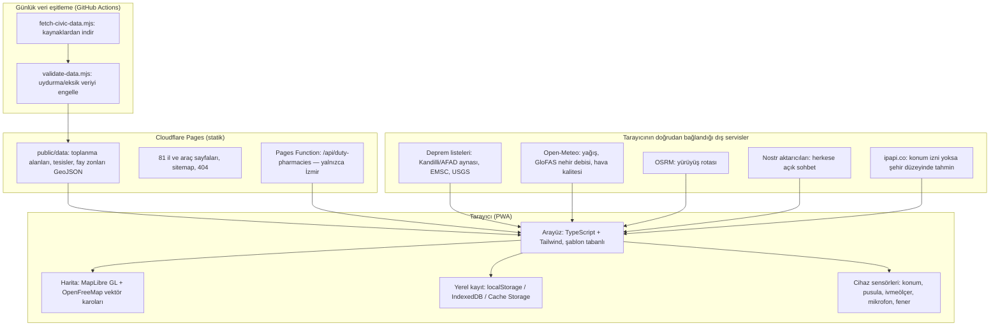
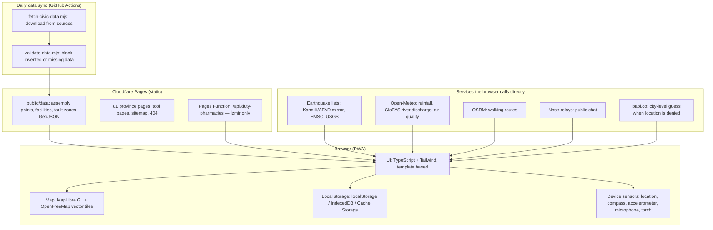

# afet.live — Türkiye Afet ve Toplanma Alanları Haritası
### Türkiye disaster, earthquake and assembly point map

[](LICENSE)
[](https://afet.live)
[](https://www.typescriptlang.org/)
[](https://vitejs.dev/)

🌐 **Site:** [https://afet.live](https://afet.live)

> Gönüllü, bağımsız bir projedir; bir kamu kurumu yayını değildir. Acil durumda **112**'yi arayın.
> An independent volunteer project, not a government service. In an emergency call **112**.

---

## 📌 Dil Seçimi / Language Selection
- [🇹🇷 Türkçe](#-türkçe-afetlive--türkiye-afet-ve-toplanma-alanları-haritası)
  - [1. Genel Bakış ve Amaç](#1-genel-bakış-ve-amaç)
  - [2. Mimari](#2-mimari)
  - [3. Araçlar](#3-araçlar)
  - [4. Veri Kaynakları & Doğruluk](#4-veri-kaynakları--doğruluk)
  - [5. Gizlilik](#5-gizlilik)
  - [6. Sohbet Korumaları ve Sorumluluk Reddi](#6-sohbet-korumaları-ve-sorumluluk-reddi)
  - [7. Kurulum ve Yerel Çalıştırma](#7-kurulum-ve-yerel-çalıştırma)
- [🤝 Katkıda Bulunun / Contributing](#katkıda-bulunun)
- [🇬🇧 English](#-english-afetlive--türkiye-disaster-and-assembly-point-map)
  - [1. Overview & Purpose](#1-overview--purpose)
  - [2. System Architecture](#2-system-architecture)
  - [3. Tools](#3-tools)
  - [4. Telemetry & Data Sources](#4-telemetry--data-sources)
  - [5. Privacy](#5-privacy)
  - [6. Chat Safeguards & Disclaimer](#6-chat-safeguards--disclaimer)
  - [7. Installation & Local Development](#7-installation--local-development)

---

# 🇹🇷 Türkçe: afet.live — Türkiye Afet ve Toplanma Alanları Haritası

## 1. Genel Bakış ve Amaç

**afet.live**, deprem, sel ve benzeri afetlerde en yakın toplanma alanını, hastaneyi ve eczaneyi bulmayı kolaylaştıran, yanında afet hazırlık araçları sunan **açık kaynaklı, bağımsız ve gönüllü** bir web uygulamasıdır. Bir kamu kurumu yayını değildir; acil durumda her zaman **112**'yi arayın ve yetkili kurumların duyurularını izleyin.

Ne yapar, ne yapmaz:

- **Harita ve veri:** 27.331 toplanma alanı, 953 hastane, 25.442 eczane, kan bağış noktaları ve basitleştirilmiş fay zonları tek haritada. Verilerin nereden geldiği ve sınırları [Veri Kaynakları](#4-veri-kaynakları--doğruluk) bölümünde.
- **Çevrimdışı kullanım (kısmi):** Uygulama bir PWA'dır. İnternet varken açılıp veriler kaydedildiyse toplanma alanları ve hastaneler çoğu durumda internetsiz de görüntülenebilir. Tarayıcı kayıtlı veriyi silebilir; çevrimdışı açılış kesin değildir. Harita görüntüsü, yürüyüş rotası, son depremler, sel/hava verisi ve sohbet internet gerektirir.
- **Erken uyarı değildir:** Son depremler listesi olayı sarsıntıdan sonra gösterir. Uygulama deprem, tsunami ya da sel için erken uyarı vermez.
- **Kimseye haber vermez:** Uygulama 112'ye ya da başka bir kuruma kendiliğinden bildirim göndermez. SMS ve paylaşım düğmeleri yalnızca telefonunuzda bir taslak açar; alıcıyı siz seçersiniz.
- **Konum:** Acil durum mesajlarına koordinat yalnızca cihazın gerçek GPS ölçümü varsa eklenir. Konum izni yoksa uygulama bunu açıkça söyler.
- **Veri uydurulmaz:** Kaynakta olmayan bilgi "bilinmiyor" olarak gösterilir; bağlantı yokken örnek ya da tahmini veri gösterilmez.

---

## 2. Mimari



- **Yığın:** Vite 6, TypeScript, Tailwind CSS, MapLibre GL, vite-plugin-pwa, Cloudflare Pages ve Pages Functions.
- **Sunucu tarafı:** Kullanıcı verisi tutan bir sunucu yoktur. Tek sunucu işlevi, İzmir Büyükşehir Belediyesi açık verisinden günün nöbetçi eczanelerini aktaran `/api/duty-pharmacies` işlevidir.
- **Veri hattı:** Veriler günde bir kez kaynaklarından indirilir; `validate-data.mjs` eksik, Türkiye dışında kalan, kaynağı belirsiz ya da kaynakta olmayan alanları içeren veriyi yayına çıkarmaz.
- **Dış kaynaklı metin:** OpenStreetMap, deprem ve rota servisleri ile sohbet içerikleri sayfaya yazılmadan önce temizlenir ([`src/utils/safeText.ts`](src/utils/safeText.ts)). Sohbetteki Nostr olaylarının imzası doğrulanır.
- **Konum kaynağı:** [`src/utils/locationState.ts`](src/utils/locationState.ts) konumun GPS, önceki GPS kaydı, IP tahmini ya da paylaşılan bağlantıdan gelip gelmediğini izler.

---

## 3. Araçlar

Araçların tamamı genel bilgilendirme ve hazırlık amaçlıdır; ilk yardım eğitiminin, yetkili kurum uyarılarının ya da uzman değerlendirmesinin yerini tutmaz.

### Harita ve konum

- **Toplanma alanları, hastaneler, eczaneler, kan bağış noktaları:** En yakın noktalar mesafe ve yön bilgisiyle listelenir. İzmir'de günün nöbetçi eczaneleri belediye açık verisinden gelir; diğer illerde e-Devlet sorgusuna bağlantı verilir.
- **Son depremler:** Kandilli ve AFAD listelerinden son depremler; 20 saniyede bir yenilenir. Yakında yeni bir deprem listeye düşerse bildirim gösterir (erken uyarı değildir).
- **Yürüyüş rotası:** İnternet varken OSRM ile sokak rotası çizer. Rota alınamazsa yalnızca yaklaşık yönü gösterir ve bunu belirtir.
- **Toplanma alanı pusulası:** En yakın toplanma alanının yönünü gösterir; pusula sensörü ve konum gerekir.
- **Plus Code:** Konumunuzu yaklaşık 14 metrelik kareyi gösteren koda çevirir, NATO fonetik alfabesiyle okunuşunu verir. Kod hesabı çevrimdışı çalışır.
- **Çevrimdışı kullanım için kaydet:** Temel verileri ve çevrenizdeki harita karolarını cihaza kaydeder; kaç dosyanın kaydedildiğini gösterir.

### Çevre ve risk tahminleri

- **Sel ve taşkın riski tahmini:** Open-Meteo yağış verisi ve GloFAS nehir debisi tahminine dayalı kaba gösterge. Veri alınamazsa bunu söyler.
- **Hava kalitesi:** Open-Meteo / Copernicus CAMS model tahmini. Kapalı alandaki karbonmonoksiti ya da enkaz tozunu ölçmez.
- **Tsunami bilgi ve kıyı tahliye rehberi:** Sabit bilgilendirme metni; tsunami uyarısı vermez, deniz seviyesi ölçmez.
- **Bina deprem farkındalık kartı:** Basitleştirilmiş fay zonlarına yaklaşık mesafe ve bina yaşına göre kaba tahmin. Mühendislik analizi değildir.
- **Hasarlı binadan uzak durma mesafesi:** Bina yüksekliğinin en az 1,5 katı kuralıyla tahmini mesafe.
- **Orman yangınında yön rehberi:** Sizin seçtiğiniz rüzgar yönüne göre rüzgara dik olası uzaklaşma yönleri. Yangının yerini bilmez.
- **Çığ eğimi, rüzgar soğuğu ve hipotermi:** Rüzgar soğuğu hesabı ve telefonla eğim ölçümü. Çığ bülteni değildir.
- **KBRN rehberi:** Kapalı alanda korunma ve rüzgara göre uzaklaşma için genel bilgi.

### İletişim ve paylaşım

- **Acil durum SMS taslağı ve acil hatlar:** 112'yi arama düğmesi ve yakınlarınıza gönderilecek mesaj taslağı.
- **SOS ve "güvendeyim" mesajı, QR durum paketi, aile afet kartı, apartman afişi:** Paylaşılabilir metin, QR ve yazdırılabilir çıktılar üretir.
- **Afet sohbeti (BitChat):** Nostr aktarıcıları üzerinden herkese açık sohbet. İnternet gerekir, mesajları kimse teyit etmez, gönderilemeyen mesaj "iletilmedi" olarak işaretlenir. 112'nin yerini tutmaz.
- **İhtiyaç listesi ve toplanma alanı durum notu:** Gönüllü notları; sohbet kanalında paylaşılır, teyitsizdir.
- **Sesli not kaydı:** Kaydı yalnızca cihazda saklar ve hoparlörden çalar. Telsiz değildir, kimseye iletmez.
- **PMR446 kanal listesi:** Lisanssız el telsizi kanalları ve frekansları. Belirlenmiş bir afet kanalı yoktur; amatör bantlar lisans gerektirir.
- **Acil hatlar ve yardım bilgisi:** 112, Kızılay 168, ALO 184, ALO 144.

### Dikkat çekme ve telefon sensörleri

- **Afet düdüğü:** Hoparlörden yaklaşık 3 kHz yüksek sesli ton ve aralıklı bip. Yalnızca yakındakiler duyar; ekran kapanırsa ses durabilir.
- **Fener / ekran S.O.S ışığı:** Cihaz izin veriyorsa feneri, vermiyorsa ekranı S.O.S ritminde yakıp söndürür.
- **Gürültü eşiği uyarıcısı (deneysel):** Mikrofondaki ses seviyesi eşiği aşınca bip çalar; sesin kaynağını ayırt edemez.
- **Gece nöbeti:** Telefon sabitken güçlü ve sürekli sarsıntı algılarsa alarm çalar; çalacağı kesin değildir.
- **Telefon ivmeölçer göstergesi:** Telefonun kendi titreşimini gösterir; deprem tespiti yapmaz.
- **Pil tasarrufu modu:** Arayüzü siyaha çevirir, haritayı karartır, animasyonları kapatır. Tasarruf miktarı ölçülmemiştir.

### İlk yardım ve sağlık (genel bilgi)

- **İlk yardım rehberi, kalp masajı metronomu (110/dk), turnike süre takibi, START triyaj yardımcısı** (çok yaralılı durumlar ve eğitimli kişiler için), **psikolojik ilk yardım ve kutu nefesi, bebek besleme rehberi, çadırda ısınma ve karbonmonoksit belirti listesi, su dezenfeksiyonu hesaplayıcısı.**
- **İlaç listem ve kilit ekranı tıbbi kimlik kartı:** Yalnızca sizin yazdığınız bilgileri içerir; cihazda saklanır.

### Hazırlık

- **Deprem çantası kontrol listesi ve son kullanma tarihi takibi, aile su ve erzak hesaplayıcısı** (kişi başı günde toplam 15 litre su, yaklaşık 3 litresi içme; 2.100 kcal), **ev içi tehlike avı** (eşya sabitleme), **evcil hayvan hazırlık rehberi, deprem tatbikat simülatörü** (tatbikat olduğu ekranda belirtilir).
- **Kişisel hasar notları, evrak notları, gönüllü bilgi kartı:** Kişisel kayıtlardır; belge, delil ya da yetki sayılmaz. Cihazda şifrelenmeden saklanır.
- **Enkaz işaretlerini okuma yardımcısı:** Basitleştirilmiş kılavuz; arama ekiplerinin el kitabının yerini tutmaz.

---

## 4. Veri Kaynakları & Doğruluk

> **Önemli:** afet.live bağımsız, gönüllü bir projedir; AFAD, Sağlık Bakanlığı veya başka bir kurumla resmi bir bağı yoktur. Afet anında her zaman **112** ve resmi kurum duyurularını esas alın.

| Veri Seti | Kaynak | Kapsam ve Sınırlar |
| :--- | :--- | :--- |
| **Toplanma Alanları** | AFAD / e-Devlet verisinin açık kaynak GitHub aynaları ([geogow](https://github.com/Ilyas-jpg/geogow), [afad-toplanma-alani-acik-veri](https://github.com/RKursatV/afad-toplanma-alani-acik-veri)) | 27.331 alan, 68 il. Kaynakta alan (m²) var, gösteriliyor. Su, elektrik, çadır alanı ve kişi kapasitesi kaynakta yok, bu yüzden gösterilmiyor. |
| **Hastaneler** | T.C. Sağlık Bakanlığı HealthTürkiye kurum kayıtları + geogow altyapı verisi (6 büyükşehir) | Ad, konum, telefon, kurum türü ve kurumun bildirdiği yatak kapasitesi. Diş ve fizik tedavi hastaneleri hariç. Acil servis, travma merkezi ve helikopter pisti bilgisi kaynakta olmadığı için gösterilmiyor. |
| **Eczaneler** | [OpenStreetMap](https://www.openstreetmap.org/copyright) katkıcıları (ODbL), Overpass API | 25.442 eczane; 21 binden fazlasında telefon kayıtlı. **Nöbet bilgisi içermez.** |
| **Nöbetçi Eczaneler** | İzmir Büyükşehir Belediyesi Açık Veri API'si (yalnızca İzmir) | Diğer illerde uygulama [e-Devlet Nöbetçi Eczane Sorgulama](https://www.turkiye.gov.tr/saglik-titck-nobetci-eczane-sorgulama) hizmetine yönlendirir. |
| **Son Depremler** | Kandilli ve AFAD ([api.orhanaydogdu.com.tr](https://api.orhanaydogdu.com.tr) üzerinden), EMSC, USGS | Dört kaynak sırayla denenir. |
| **Fay Hatları** | Elle çizilmiş, basitleştirilmiş katman | 7 ana fay zonu. **MTA Diri Fay Haritası değildir**; bina ölçeğinde risk değerlendirmesi için kullanılmamalıdır. |
| **Kan Bağış Merkezleri** | [OpenStreetMap](https://www.openstreetmap.org/copyright) `healthcare=blood_donation` (ODbL) | OSM'de kayıtlı kan bağış noktaları. Eksikler OSM'ye eklendiğinde ertesi gün haritaya gelir. |
| **Sel ve Yağış** | [Open-Meteo](https://open-meteo.com) Flood API (GloFAS) ve Forecast API | Nehir debisi ve yağış tahmini. |
| **Hava Kalitesi** | Open-Meteo Air Quality API (Copernicus CAMS) | AQI, PM2.5, PM10, CO. |
| **Harita Altlığı** | [OpenFreeMap](https://openfreemap.org) (OpenStreetMap verisi) | Vektör karolar. |

### Veri Dürüstlüğü İlkesi

Bu bir afet uygulaması: yanlış bir adres ya da telefon numarası, hiç bilgi olmamasından daha tehlikelidir. Bu yüzden:

- **Veri asla üretilmez.** Kaynakta olmayan isim, telefon, adres, konum, kapasite veya çalışma saati "doldurulmaz"; bilinmiyorsa arayüzde "bilinmiyor" yazar.
- **Kaynak her zaman belirtilir** ve "resmi" ya da "doğrulanmış" kelimeleri yalnızca gerçekten öyle olan veri için kullanılır.
- **Otomatik doğrulama:** [`scripts/validate-data.mjs`](scripts/validate-data.mjs) her build'de ve günlük veri senkronunda çalışır. Eksik, Türkiye dışında kalan, kaynağı belirsiz veya şablonla üretilmiş görünen veri yayına çıkamaz.
- **Dış kaynaklı metin güvenilmezdir:** OSM, açık veri ve Nostr içerikleri HTML'e yazılmadan önce temizlenir ([`src/utils/safeText.ts`](src/utils/safeText.ts)).

---

## 5. Gizlilik

- **Hesap ve kullanıcı veritabanı yok:** afet.live kullanıcı hesabı, telefon numarası, konum ya da mesaj saklamaz.
- **Yerel Depolama:** Afet çantası, aile bilgileri ve ICE kilit ekranı verileri yalnızca kullanıcının telefonundaki `LocalStorage` ve `IndexedDB` belleğinde şifresiz tutulur ve üçüncü taraflarla paylaşılmaz.
- **Üçüncü taraf servisler isteklerinizi görür:** Tarayıcı harita karosu, deprem, hava ve rota servislerine doğrudan bağlanır. Rota ve hava istekleri sorduğunuz koordinatı içerir. Konum izni verilmezse uygulama IP adresinizden şehir düzeyinde tahmin için ipapi.co'ya sorar.
- **Sohbet kimliği:** Cihazda bir Nostr anahtar çifti üretilir. Sıfırlama yeni anahtar oluşturur; daha önce gönderilen mesajlar aktarıcılarda kalır.
- **BitChat mesajları herkese açıktır:** Nostr üzerinden gönderilen mesajlar afet.live'ın değil, üçüncü taraf Nostr relay'lerinin (ör. relay.damus.io, nos.lol) sunucularında saklanır ve herkes tarafından okunabilir. Kişisel bilgi, adres veya sağlık bilgisi paylaşmayın.
- **Barındırma:** Site Cloudflare Pages üzerinde çalışır; Cloudflare standart erişim kayıtlarını (IP, tarayıcı bilgisi) kendi politikası doğrultusunda işler.

---

## 6. Sohbet Korumaları ve Sorumluluk Reddi

Sohbet herkese açıktır ve herkes yazabilir; bu yüzden mesajlar teyitsiz kabul edilmelidir. Uygulamanın gerçekten yaptıkları:

- **İstek sınırlama:** SOS, sohbet, "hissettim" ve yardım mesajları için cihazda bekleme süreleri vardır; tek cihaz art arda basarak kanalı dolduramaz.
- **Gönderimde iş ispatı:** Gönderen cihaz yayınlamadan önce küçük bir SHA-256 bulmacası çözer; bu toplu gönderimi yavaşlatır. Gelen mesajlar buna göre sıralanmaz ya da rozetlenmez.
- **İmza denetimi:** İmzası geçersiz Nostr olayları atılır; her rumuzun yanında kısa bir açık anahtar öneki gösterilir, böylece bir isim sessizce taklit edilemez.
- **Söylenti kalıbı denetimi:** Bilinen panik kalıplarına ("baraj patladı" gibi) uyan mesajlar gönderenin ve okuyanın ekranında uyarı etiketiyle gösterilir.
- **Oy değil, kişisel not:** "Güvenilir / şüpheli" işaretleri yalnızca sizin cihazınızdaki notlardır; paylaşılmaz ve topluluk teyidi yoktur.
- **Sorumluluk reddi:** Her iletişim ekranında afet.live'ın gönüllü bir rehber olduğu, 112'nin ve yetkili kurumların yerini tutmadığı yazar. TCK m. 217/A uyarınca bilerek yanıltıcı bilgi yaymak suçtur; mesajın sorumluluğu gönderene aittir.

Mesajlar için konum teyidi ve moderasyon yoktur.

---

## Katkıda Bulunun

afet.live tek kişinin gönüllü emeğiyle başladı ve kamu yararına açık kaynak. Kod, veri doğrulama, tasarım, çeviri ya da sahadan geri bildirim: her katkı değerli. Başlamak için [CONTRIBUTING.md](CONTRIBUTING.md) dosyasına ve [açık konulara](https://github.com/himmetaga/turkiye-afet-haritasi/issues) bakın.

### Yardım Aranan Konular

- **Toplanma alanı olanakları:** Su, elektrik, çadır alanı ve kapasite bilgisi kaynakta yok. Gerçek verisi olan illerden (belediye açık verileri) eklenmeli.
- **Hastane bilgileri:** Acil servis, helikopter pisti ve travma merkezi bilgisi için resmi ve güvenilir bir kaynak gerekiyor.
- **Nöbetçi eczane verisi:** İzmir dışındaki iller için izinli ve resmi bir kaynak (il eczacı odaları, belediye açık veri portalları).
- **Kan bağış noktaları:** Bölgenizdeki Kızılay kan merkezini OpenStreetMap'e `healthcare=blood_donation` etiketiyle ekleyin; haritaya otomatik gelir.
- **Gerçek fay verisi:** Basitleştirilmiş katman yerine lisansı uygun, kaynağı belli bir diri fay verisi.
- **Tıbbi ve güvenlik içeriğinin uzman gözüyle incelenmesi:** İlk yardım, triyaj, su dezenfeksiyonu, KBRN ve bebek besleme metinleri genel kaynaklardan derlendi; hekim ve afet uzmanı incelemesine ihtiyaç var.
- **Testler:** Henüz otomatik test yok; yardımcı fonksiyonlar için birim testleri ve temel uçtan uca testler.
- **Erişilebilirlik:** WCAG uyumluluğu ve ekran okuyucu desteği.

### Yerel Kontroller

```bash
npm run fetch:data      # Verileri kaynaklarından yeniden indir (birkaç dakika sürer)
npm run validate:data   # Yayın verisini doğrula
npm run build           # Doğrulama + TypeScript + üretim paketi
```

---

## 7. Kurulum ve Yerel Çalıştırma

Projeyi kendi bilgisayarınızda yerel ortamda çalıştırmak için:

```bash
# 1. Repoyu klonlayın
git clone https://github.com/himmetaga/turkiye-afet-haritasi.git
cd turkiye-afet-haritasi

# 2. Bağımlılıkları yükleyin
npm install

# 3. Geliştirme sunucusunu başlatın
npm run dev
```

Tarayıcınızda `http://localhost:5173` adresine giderek uygulamayı görüntüleyebilirsiniz.

### Üretim Paketini Derleme
```bash
# Kamu verilerini güncelle ve üretim kodunu derle
npm run build

# Derlenen üretim paketini önizle
npm run preview
```

---

<br />

# 🇬🇧 English: afet.live — Türkiye Disaster and Assembly Point Map

## 1. Overview & Purpose

**afet.live** is an **open-source, independent, volunteer-run** web app that helps people in Türkiye find the nearest assembly point, hospital and pharmacy during earthquakes, floods and other disasters, and offers a set of preparedness tools. It is not a government service. In an emergency, always call **112** and follow announcements from the authorities.

What it does and does not do:

- **Map and data:** 27,331 assembly points, 953 hospitals, 25,442 pharmacies, blood donation points and a simplified fault-zone layer on one map. See [Data Sources](#4-telemetry--data-sources) for origins and limits.
- **Offline use (partial):** the app is a PWA. If it was opened and the data saved while online, assembly points and hospitals can usually be viewed without a connection. The browser may evict saved data, so offline start-up cannot be promised. Map imagery, walking routes, recent earthquakes, flood/air data and chat need the internet.
- **Not an early warning system:** the earthquake list shows events after the shaking. The app gives no early warning for earthquakes, tsunamis or floods.
- **It notifies nobody:** the app never contacts 112 or any authority by itself. SMS and share buttons only open a draft on your phone; you choose the recipient.
- **Location:** coordinates are added to emergency messages only when the device has a real GPS fix. Without location permission the app says so.
- **No invented data:** anything missing from the source is shown as "unknown"; no sample or estimated data is shown when a source is unreachable.

---

## 2. System Architecture



- **Stack:** Vite 6, TypeScript, Tailwind CSS, MapLibre GL, vite-plugin-pwa, Cloudflare Pages and Pages Functions.
- **Server side:** there is no server that stores user data. The only server function is `/api/duty-pharmacies`, which relays today's on-duty pharmacies from İzmir Metropolitan Municipality open data.
- **Data pipeline:** data is downloaded from its sources once a day; `validate-data.mjs` blocks data that is missing, outside Türkiye, unsourced, or that contains fields the source does not provide.
- **External text:** content from OpenStreetMap, the earthquake and routing services and the chat is sanitised before it is written to the page ([`src/utils/safeText.ts`](src/utils/safeText.ts)). Nostr events in the chat are signature-checked.
- **Location source:** [`src/utils/locationState.ts`](src/utils/locationState.ts) tracks whether the position came from GPS, an earlier GPS fix, an IP guess or a shared link.

---

## 3. Tools

All tools are for general information and preparedness. They do not replace first-aid training, warnings from the authorities or expert assessment.

### Map and location

- **Assembly points, hospitals, pharmacies, blood donation points:** nearest places listed with distance and direction. In İzmir, today's on-duty pharmacies come from municipal open data; elsewhere the app links to the e-Devlet lookup.
- **Recent earthquakes:** from the Kandilli and AFAD lists, refreshed every 20 seconds. Shows a notice when a nearby event appears in the list (not an early warning).
- **Walking route:** street route via OSRM when online. If no route is available it shows only the approximate direction and says so.
- **Assembly point compass:** points to the nearest assembly point; needs a compass sensor and a location.
- **Plus Code:** converts your position to a code for a square of roughly 14 metres and spells it in the NATO phonetic alphabet. The code maths works offline.
- **Save for offline use:** saves the core datasets and nearby map tiles on the device and reports how many files were stored.

### Environment and risk estimates

- **Flood risk estimate:** a rough indicator from Open-Meteo rainfall and GloFAS river-discharge forecasts. Says so when data is unavailable.
- **Air quality:** an Open-Meteo / Copernicus CAMS model estimate. It does not measure indoor carbon monoxide or debris dust.
- **Tsunami information and coastal evacuation guide:** static guidance; no tsunami warning, no sea-level data.
- **Building earthquake awareness card:** approximate distance to the simplified fault zones plus a rough estimate from building age. Not an engineering analysis.
- **Stand-off distance from a damaged building:** an estimate using at least 1.5 times the building height.
- **Wildfire direction guide:** possible crosswind directions for the wind direction you select. It does not know where the fire is.
- **Avalanche slope, wind chill and hypothermia:** wind-chill calculation and slope measurement with the phone. Not an avalanche bulletin.
- **CBRN guide:** general information on sheltering indoors and moving away relative to the wind.

### Communication and sharing

- **Emergency SMS draft and hotlines:** a call-112 button and a message draft for your relatives.
- **SOS and "I am safe" message, QR status pack, family meeting card, apartment poster:** shareable text, QR codes and printable sheets.
- **Disaster chat (BitChat):** public chat over Nostr relays. Needs the internet, nobody verifies messages, and unsent messages are marked as not delivered. It does not replace 112.
- **Needs list and assembly-area status note:** volunteer notes shared in the public chat, unverified.
- **Voice note:** stores a recording on the device and plays it through the speaker. It is not a radio and transmits to nobody.
- **PMR446 channel list:** licence-free handheld radio channels and frequencies. There is no designated disaster channel; amateur bands need a licence.
- **Hotlines and help information:** 112, Kızılay 168, ALO 184, ALO 144.

### Attention signals and phone sensors

- **Disaster whistle:** a loud tone of about 3 kHz and intermittent beeps from the speaker. Only people nearby can hear it, and it may stop when the screen turns off.
- **Torch / screen S.O.S light:** flashes the torch where the device allows it, otherwise the screen, in the S.O.S pattern.
- **Noise threshold alert (experimental):** beeps when the microphone level passes a threshold; it cannot tell what made the sound.
- **Night watch:** sounds an alarm if the resting phone detects strong, sustained shaking; it is not certain to trigger.
- **Phone accelerometer display:** shows the phone's own vibration; it does not detect earthquakes.
- **Battery saver mode:** turns the interface black, dims the map and disables animations. The saving has not been measured.

### First aid and health (general information)

- **First-aid guide, CPR metronome (110/min), tourniquet time tracker, START triage aid** (for multi-casualty situations and trained people), **psychological first aid and box breathing, infant feeding guide, tent heating and carbon-monoxide symptom list, water disinfection calculator.**
- **My medication list and lock-screen medical ID card:** contain only what you type; stored on the device.

### Preparedness

- **Go-bag checklist and expiry-date tracker, family water and food calculator** (15 litres of water per person per day in total, about 3 litres for drinking; 2,100 kcal), **home hazard hunt** (securing furniture), **pet preparedness guide, earthquake drill simulator** (labelled as a drill on screen).
- **Personal damage notes, document notes, volunteer info card:** personal records only; they are not documents, evidence or authorisation. Stored unencrypted on the device.
- **Rubble marking reading aid:** a simplified guide; it does not replace the search teams' manual.

---

## 4. Telemetry & Data Sources

> **Important:** afet.live is an independent volunteer project with no official affiliation with AFAD, the Ministry of Health or any other authority. In an emergency, always call **112** and follow official announcements.

| Dataset | Source | Coverage & Limits |
| :--- | :--- | :--- |
| **Assembly Points** | Open-source GitHub mirrors of AFAD / e-Government data ([geogow](https://github.com/Ilyas-jpg/geogow), [afad-toplanma-alani-acik-veri](https://github.com/RKursatV/afad-toplanma-alani-acik-veri)) | 27,331 sites in 68 provinces. Area (m²) comes from the source and is shown. Water, power, tent area and headcount capacity are not in the source, so they are not shown. |
| **Hospitals** | Ministry of Health HealthTürkiye facility records + geogow infrastructure data (6 metros) | Name, location, phone, facility type and the bed capacity reported by the facility. Dental and physiotherapy hospitals excluded. ER, trauma-center and helipad info is not in the source, so it is not shown. |
| **Pharmacies** | [OpenStreetMap](https://www.openstreetmap.org/copyright) contributors (ODbL), Overpass API | 25,442 pharmacies, 21k+ with phone numbers. **No on-duty information.** |
| **On-Duty Pharmacies** | İzmir Metropolitan Municipality open-data API (İzmir only) | Elsewhere the app links to the official [e-Devlet on-duty pharmacy lookup](https://www.turkiye.gov.tr/saglik-titck-nobetci-eczane-sorgulama). |
| **Recent Earthquakes** | Kandilli & AFAD (via [api.orhanaydogdu.com.tr](https://api.orhanaydogdu.com.tr)), EMSC, USGS | Four sources tried in order. |
| **Fault Lines** | Hand-drawn simplified layer | 7 major fault zones. **Not the MTA Active Fault Map**; do not use for building-level risk. |
| **Blood Donation Centers** | [OpenStreetMap](https://www.openstreetmap.org/copyright) `healthcare=blood_donation` (ODbL) | Blood donation points mapped in OSM; additions to OSM show up the next day. |
| **Flood & Rainfall** | [Open-Meteo](https://open-meteo.com) Flood API (GloFAS) and Forecast API | River discharge and precipitation forecasts. |
| **Air Quality** | Open-Meteo Air Quality API (Copernicus CAMS) | AQI, PM2.5, PM10, CO. |
| **Basemap** | [OpenFreeMap](https://openfreemap.org) (OpenStreetMap data) | Vector tiles. |

**Data honesty rule:** data is never generated or filled in. If the source does not have a phone number, address, location, capacity or opening hours, the UI says "unknown". [`scripts/validate-data.mjs`](scripts/validate-data.mjs) runs on every build and before the daily sync commits, and blocks missing, out-of-bounds, unsourced or templated-looking data.

---

## 5. Privacy

- **No accounts, no user database:** afet.live keeps no database of user identities, coordinates or messages.
- **Client-side storage:** your settings and notes (go-bag list, family data, medical ID, document notes) stay in the browser's `localStorage` and `IndexedDB`, unencrypted, and are lost if site data is cleared.
- **Third-party services see your requests:** the browser calls the map tile, earthquake, weather and routing services directly. Routing and weather requests include the coordinates you ask about. If location permission is denied, the app asks ipapi.co for a city-level guess from your IP address.
- **Chat identity:** a Nostr key pair is generated on the device. Resetting it creates a new key, but messages already sent stay on the relays.
- **BitChat messages are public:** messages sent over Nostr are stored on third-party Nostr relays (e.g. relay.damus.io, nos.lol), not by afet.live, and anyone can read them. Do not share personal, address or health details.
- **Hosting:** the site runs on Cloudflare Pages; Cloudflare processes standard access logs (IP, user agent) under its own policy.

---

## 6. Chat Safeguards & Disclaimer

The chat is public and anyone can write to it, so messages must be treated as unverified. What the app actually does:

- **Rate limiting:** local cooldowns for SOS, chat, felt-report and aid messages, so one device cannot flood the channel by repeated taps.
- **Proof of work on send:** the sending device solves a small SHA-256 puzzle before publishing, which slows down bulk posting. Received messages are not ranked or badged by it.
- **Signature check:** incoming Nostr events with an invalid signature are dropped, and a short public-key prefix is shown beside each alias so that names cannot be impersonated silently.
- **Rumour wording check:** messages matching known panic patterns (for example "the dam has burst") get a warning label on the sender's and readers' screens.
- **Personal notes, not votes:** "trustworthy / suspicious" marks are private notes on your own device; they are not shared and there is no community verification.
- **Disclaimer:** every communication screen states that afet.live is a volunteer guide and does not replace 112 or the authorities. Under Article 217/A of the Turkish Penal Code, knowingly spreading false information is a crime; responsibility for a message lies with its sender.

There is no location verification of messages and no moderation.

---

## 7. Installation & Local Development

To run afet.live locally on your machine:

```bash
# 1. Clone repository
git clone https://github.com/himmetaga/turkiye-afet-haritasi.git
cd turkiye-afet-haritasi

# 2. Install dependencies
npm install

# 3. Start development server
npm run dev
```

Visit `http://localhost:5173` in your browser.

### Building for Production
```bash
# Fetch latest civic telemetry and compile production bundle
npm run build

# Preview production build locally
npm run preview
```

---

## 📄 Lisans / License

Bu proje [MIT Lisansı](LICENSE) kapsamında kamu yararına açık kaynak olarak sunulmaktadır.  
This project is open-source under the terms of the [MIT License](LICENSE).
