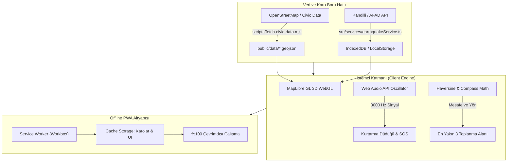

# Türkiye 3D Afet ve Toplanma Atlası 🇹🇷
### Turkey 3D Disaster & Assembly Atlas (Offline-First PWA)

[](LICENSE)
[](.nvmrc)
[](https://developer.mozilla.org/en-US/docs/Web/Progressive_web_apps)
[](https://maplibre.org/)
[](https://pages.cloudflare.com/)

---

## 📌 Genel Bakış ve Vizyon (Overview & Vision)

**Türkiye 3D Afet ve Toplanma Atlası**, deprem ve acil durumlarda vatandaşların en yakın toplanma alanlarına internet bağlantısı olmasa dahi saniyeler içinde ulaşabilmesini sağlayan, açık kaynaklı, kamu yararına geliştirilmiş yeni nesil bir coğrafi bilgi sistemi (GIS) ve sismik izleme platformudur.

Geleneksel afet sistemleri genellikle merkezi veritabanlarına ve kesintisiz internet bağlantısına bağımlıdır. Büyük depremlerde baz istasyonlarının çökmesi veya elektrik kesintileri yaşandığında bu sistemler erişilemez hale gelir. Bu atlas, **sıfır sunucu maliyetli (Zero-Egress Edge)** ve **tam çevrimdışı (Offline-First PWA)** mimari ile tasarlanmıştır. Tüm toplanma alanı koordinatları, harita karoları ve acil durum mekanizmaları cihazınızın yerel depolama alanında saklanır.

---

## ✨ Öne Çıkan Yetenekler (Core Features)

* **🏙️ 3B Vektör Harita ve Bina Yükseklikleri**: MapLibre GL JS ve donanım hızlandırmalı WebGL ile 60 FPS akıcılıkta 3 boyutlu şehir binaları, derinlik ve gölgelendirme efektleri.
* **📍 En Yakın 3 Toplanma Alanı & Pusula Yönü**: Kullanıcının anlık konumuna veya haritada seçtiği noktaya göre kuş uçuşu mesafe (m), tahmini yürüyüş süresi (dk), pusula yön açısı (°) ve altyapı olanakları (Su, Elektrik, Çadır Alanı, Jeneratör).
* **⚡ Canlı Sismik Dalga Simülasyonu (Kandilli & AFAD)**: Son 24 saat içinde gerçekleşen depremleri büyüklüklerine göre (M < 3.0 kehribar, M ≥ 4.0 parlak kırmızı) harita üzerinde genişleyen dinamik radar halkalarıyla simüle eder.
* **📢 3000 Hz Web Audio Kurtarma Düdüğü**: Arama-kurtarma ekiplerinin ve insan kulağının en net duyabildiği 3000 Hz rezonans frekansında, hiçbir ses dosyasına ihtiyaç duymadan doğrudan tarayıcı osilatörüyle çalışan acil durum sinyali.
* **📋 Tek Dokunuşla SOS Koordinat Paylaşımı**: Enkaz altında veya karanlıkta yer bildirmek için GPS koordinatlarını ve en yakın toplanma alanını otomatik olarak SMS veya WhatsApp formatına dönüştürür.
* **🔒 0.8s Bilinçli Dokunuş (Press-and-Hold)**: Kritik acil durum fonksiyonlarının yanlışlıkla tetiklenmesini engelleyen görsel dolum onay mekaniği.
* **📶 %100 Çevrimdışı Çalışma (Offline-First PWA)**: Service Worker ve IndexedDB altyapısıyla şebeke tamamen kesildiğinde dahi kesintisiz çalışan harita ve veritabanı.

---

## 🏛️ Mimari Şema (Architecture)



---

## 🚀 Hızlı Başlangıç (Quick Start)

### Gereksinimler
- Node.js 22.x veya üzeri
- npm 10.x veya üzeri

### Kurulum Adımları

```bash
# 1. Depoyu klonlayın
git clone https://github.com/himmetaga/turkiye-afet-haritasi.git
cd turkiye-afet-haritasi

# 2. Bağımlılıkları yükleyin
npm install

# 3. Toplanma alanları GeoJSON veri setini üretin
npm run fetch:data

# 4. Geliştirme sunucusunu başlatın
npm run dev
```

Uygulama `http://localhost:5173` adresinde çalışmaya başlayacaktır.

### Üretim Derlemesi (Production Build)

```bash
npm run build
npm run preview
```

---

## ☁️ Cloudflare Pages Dağıtımı (Deployment)

Proje, Cloudflare Pages üzerinde **sıfır sunucu ve sıfır bant genişliği maliyetiyle** çalışacak şekilde yapılandırılmıştır.

[](https://deploy.workers.cloudflare.com/?url=https://github.com/himmetaga/turkiye-afet-haritasi)

**Cloudflare Ayarları:**
- **Framework Preset**: Vite
- **Build Command**: `npm run fetch:data && npm run build`
- **Build Output Directory**: `dist`
- **Node.js Version**: `22`

---

## 🧭 English Summary

**Turkiye 3D Disaster & Assembly Atlas** is an open-source, offline-first progressive web application built to guide citizens to verified emergency assembly zones during earthquakes and crises.

### Key Highlights
- **Zero Server Costs**: Static GeoJSON files distributed via edge CDNs with immutable caching headers.
- **Offline-First PWA**: Full service worker caching for map tiles and vector geometry.
- **3D Building Extrusions**: Realistic urban elevation via WebGL and MapLibre GL.
- **3000 Hz Acoustic Rescue Whistle**: Native Web Audio API oscillator for emergency search and rescue signaling.
- **Instant SOS Dispatch**: Formats current GPS coordinates and nearest safe zone into SMS and messenger alerts.

---

## 📄 Lisans (License)

Bu proje [MIT Lisansı](LICENSE) altında açık kaynak olarak sunulmaktadır.
Geliştirici: **Himmet Aytulum**
