# afet.live — Türkiye Afet, Deprem ve Acil Durum Atlası
### Turkey Disaster Resilience, Earthquake & Emergency Survival Atlas

[](LICENSE)
[](https://afet.live)
[](https://www.typescriptlang.org/)
[](https://vitejs.dev/)
[](https://afet.live)

🌐 **Canlı Uygulama / Live Site:** [https://afet.live](https://afet.live)

---

## 📌 Dil Seçimi / Language Selection
- [🇹🇷 Türkçe Dokümantasyon](#-türkçe-afetlive--türkiye-afet-ve-acil-durum-atlası)
  - [1. Genel Bakış ve Misyon](#1-genel-bakış-ve-misyon)
  - [2. Sistem ve Yazılım Mimarisi (8 Sütun & iOS 27)](#2-sistem-ve-yazılım-mimarisi-8-ana-mimari-sütun--ios-27-spatial-glass)
  - [3. Faydaya Göre Modül Kataloğu (40 Araç)](#3-faydaya-göre-modül-kataloğu-40-araç)
  - [4. Veri Kaynakları & Doğruluk](#4-veri-kaynakları--doğruluk)
  - [5. Gizlilik & Sıfır Veri Kaybı (Zero-Data-Retention)](#5-gizlilik--sıfır-veri-kaybı-zero-data-retention)
  - [6. Manipülasyon Önleme & Hukuki Sorumluluk Güvenliği](#6-manipülasyon-önleme--hukuki-sorumluluk-güvenliği)
  - [7. Kurulum ve Yerel Çalıştırma](#7-kurulum-ve-yerel-çalıştırma)
- [🇬🇧 English Documentation](#-english-afetlive--turkiye-disaster-resilience-and-emergency-atlas)
  - [1. Overview & Core Mission](#1-overview--core-mission)
  - [2. System Architecture](#2-system-architecture)
  - [3. Feature Catalog by Utility (33 Modules)](#3-feature-catalog-by-utility-33-modules)
  - [4. Telemetry & Data Sources](#4-telemetry--data-sources)
  - [5. Privacy & Zero Tracking Architecture](#5-privacy--zero-tracking-architecture)
  - [6. Anti-Manipulation & Legal Zero-Liability Architecture](#6-anti-manipulation--legal-zero-liability-architecture)
  - [7. Installation & Local Development](#7-installation--local-development)

---

# 🇹🇷 Türkçe: afet.live — Türkiye Afet ve Acil Durum Atlası

## 1. Genel Bakış ve Misyon

**afet.live**, Türkiye ve komşu coğrafyalarda meydana gelebilecek deprem, sel, heyelan, orman yangını, bina çökmesi ve tsunami gibi afet anlarında ve sonrasında sivil halkın, arama kurtarma gönüllülerinin ve sahra ekiplerinin hayatta kalmasını desteklemek amacıyla geliştirilmiş **açık kaynaklı, bağımsız ve çevrimdışı (offline-first)** bir sivil afet atlasıdır.

6 Şubat 2023 Kahramanmaraş depremleri ve geçmiş Marmara afetleri göstermiştir ki; afet anında hücresel baz istasyonları dakikalar içinde kilitlenmekte, merkezi sunucular çökmekte, internet erişimi kesilmekte ve elektrik şebekesi devre dışı kalmaktadır.

Bu hayati gereksinim doğrultusunda **afet.live**, **"Sıfır Sunucu Bağımlılığı (Zero Server Dependency)"** ilkesiyle tasarlanmıştır:
- Uygulama tarayıcıya veya telefona bir kez yüklendiğinde (PWA), hücresel veri, fiber internet ve Wi-Fi tamamen kopsa dahi **27.331 resmi AFAD toplanma alanı, 1.226 acil servis hastanesi, MTA diri fay haritası ve tüm hayatta kalma araçları %100 çevrimdışı çalışmaya devam eder.**
- Kullanıcının GPS konumu, kimliği veya tıbbi verileri asla harici bir sunucuya kaydedilmez; tüm hesaplamalar (Haversine mesafe, açı, triyaj, klorlama dozajı) doğrudan kullanıcının cihaz işlemcisinde yerel olarak gerçekleştirilir.

---

## 2. Sistem ve Yazılım Mimarisi (8 Ana Mimari Sütun & iOS 27 Spatial Glass)

afet.live; sıfır sunucu bağımlılığı, ultra düşük pil sarfiyatı, enkaz altı donanım otomasyonu ve bilişsel yükü sıfırlayan **iOS 27 Spatial Neo-Glassmorphism** arayüzü üzerine 8 ana sütunda inşa edilmiştir:

```mermaid
graph TD
    subgraph UI ["1. iOS 27 Sade Arayüz & Bilişsel Yük Yönetimi"]
        A[Dinamik Ada - Dynamic Island Kapsülü]
        B[Yüzen Cam Dock - Floating Spatial Dock]
        C[Bento Grid Kontrol Merkezi & Canlı Filtreleme]
        D[Hold-to-Confirm: 3sn Kazara Basma Koruması]
        E[OLED Ekstrem Güç Kalkanı: Pitch-Black 15-30Hz]
    end

    subgraph Hardware ["2. Enkaz Altı Donanım Otomasyonu & Sensörler"]
        F[3.5 - 4.2 kHz Geofon Sismik Rezonans Sentezi]
        G[Pik Darbeli Optik LED SOS: 10ms Flaş - %95 Pil Koruması]
        H[Ortam Işığı ALS: 0 Lux Enkaz Çökme Doğrulaması]
        I[Barometrik Kat & Göçük Deplasman Analitiği]
        J[Taktik Manyetometre Pusula & Yapısal Deformasyon]
        K[Bilinç Yoklaması Titreşimi & Dead-Man Kara Kutu]
    end

    subgraph Network ["3. Altyapısız İletişim & Hibrit Mesh Ağı"]
        L[DNS Tünelleme - Captive Portal Bypass: a3f2.sos.afet.live]
        M[Store-and-Forward DTN: Fiziksel İnsan Kurye Veri Ağı]
        N[Ultrasonik Yakın Alan Akustik Chirp: 18-20 kHz]
        O[LoRa & Meshtastic Donanım Köprüsü: 433/868 MHz]
        P[Nostr & WebRTC DataChannel P2P: BitChat Kriz Odası]
        Q[Dinamik Wi-Fi Hotspot SSID: SOS_A-RH+_1KISI_BILINCLI]
    end

    subgraph Intelligence ["4. Karar Destek, Triyaj & Hukuki Koruma"]
        R[110 BPM Sahra CPR Metronomu & Ezilme Sendromu Kılavuzu]
        S[START Sahra Triyaj Motoru & Turnike 120 Dk Zamanlayıcısı]
        T[Bina Hasar Tespiti, X-Çatlak Analizi & DASK 15 Gün Süre]
        U[WHO WASH Su Dezenfeksiyonu & Klorlama Dozajlayıcı]
        V[KBRN, Radyasyon & Nükleer Serpinti Sığınağı Kılavuzu]
        W[Mülkiyet Kasası & Çevrimdışı Verifiable Credentials]
        X[P2P İhtiyaç & Barter Takas Defteri]
    end

    UI --> Hardware
    Hardware --> Network
    Network --> Intelligence
```



### 🏛️ 8 Ana Mimari Sütun

#### Sütun 1: Dağıtım ve Altyapısız İletişim
- **Sunucusuz ve Statik Çekirdek:** Uygulamanın tüm mantıksal katmanları sıfır sunucu taraflı hesaplama (client-side execution) yapacak şekilde derlenmiştir; Cloudflare Edge ve GitHub Pages üzerinden global CDN ağına dağıtılır. İlk saniyelerde 10 milyon eşzamanlı giriş olsa bile sistem sıfır maliyetle kesintisiz ayakta kalır.
- **Offline-First Service Worker & IndexedDB:** PWA `Cache-First` kuralıyla tüm static asset'ler, fontlar, ses sentezleyiciler ve vektör harita karoları tek seferde önbelleğe yazılır; uçak modunda veya baz istasyonları tamamen yokken dahi 1 milisaniye gecikme olmadan çalışır.
- **Captive Portal & DNS Tünelleme (Walled Garden Bypass):** Dış internete çıkışı kapalı veya şifreli sahra Wi-Fi ağlarında UDP 53 (DNS) portunun açık kalmasından yararlanarak, enkaz koordinatı ve hayati durum verilerini Base64 formatında DNS sorgularına gömerek (`a3f2.sos.afet.live`) dış dünyaya aktarır.
- **Store-and-Forward DTN (Delay-Tolerant Networking) Taşıyıcı Modeli:** Enkaz altından BLE ile sağılan paketler, bölgeden geçen sivillerin ve sahra araçlarının cihazlarında yerel kuyruğa alınır (Data Mule); internet olan ilk sahra çadırına veya Starlink terminaline ulaştırılır.
- **Ultrasonik Yakın Alan Akustik Veri Aktarımı (18 kHz – 20 kHz):** Bluetooth yongası fiziksel darbeyle bozulmuş veya anteni kırılmış cihazlarda, dahili hoparlör ve mikrofon üzerinden insan kulağının duymadığı ses dalgalarıyla kimlik, kan grubu ve konum telemetrisi aktarılır.
- **LoRa & Meshtastic Donanım Köprüsü:** Web Bluetooth API ve Web Serial üzerinden 433/868 MHz harici LoRa telsiz modüllerine bağlanarak menzili 15 kilometreye çıkarır.
- **WebRTC P2P Yerel Ağ Kümelenmesi:** Dış kablosu kopmuş yerel yönlendiricilerde (Wi-Fi router) cihazlar mDNS üzerinden birbirini bulup doğrudan WebRTC DataChannel ile mesajlaşır.

#### Sütun 2: Erken Uyarı, Sensör Fiziği ve Algoritmik Karar Katmanı
- **P-Dalgası Diferansiyel İvmeölçer Analizi:** `DeviceMotionEvent` API ile 100 Hz frekansta ivme verisi okunur; yıkıcı ana sarsıntıyı getiren S dalgası bölgeye ulaşmadan 3 ila 45 saniye önce kaçış ve yaşam üçgeni payı kazandırır.
- **FFT Tabanlı Sahte Sarsıntı Filtreleme:** Cihazda yerel çalışan Hızlı Fourier Dönüşümü (FFT) ile sarsıntı frekans spektrumu analiz edilir; adımlama ve masa çarpması gibi 5-15 Hz titreşimler elenerek yalnızca gerçek sismik frekanslarda (0.5 – 5 Hz) alarm verilir.
- **Ortam Işığı Sensörü (ALS) ile Enkaz Doğrulama Korelasyonu:** Şiddetli darbe ivmesinde dahili ortam ışık sensörünün 0 lux (mutlak karanlık) verip vermediği kontrol edilir; cebinde yere düşen telefon ile tavanı çöken enkazı anında ayrıştırarak yardım sinyalinin güvenilirlik puanını %99'a çıkarır.
- **Barometrik Kat ve Göçük Deplasman Analitiği:** Dahili barometre (hava basıncı sensörü) verileri hPa cinsinden sürekli izlenerek deprem anındaki son GPS rakımı ile hava basıncı irtifası karşılaştırılır; kazazedenin zemin seviyesinden kaç metre aşağıda/yukarıda olduğu santimetre hassasiyetinde hesaplanır.
- **Manyetometre (Manyetik Pusula) Yapısal Deformasyon Tespiti:** Binanın kolonlarındaki betonarme donatı demirlerinin manyetik alan sapmaları analiz edilerek enkaz tavanındaki beton kütlesinin eğilme yönü ve güvenli sürünme vektörü belirlenir.
- **Bölgesel Sensör Konsensüsü:** Aynı GeoHash hücresindeki en az 10 cihazın eşzamanlı mikro-sarsıntı üretmesi durumunda yerel ağa alarm yayını yapılır.

#### Sütun 3: Enkaz Altı Donanım Otomasyonu ve Hayat İkaz Protokolleri
- **Akustik-Sismik Dinleme Frekansı Modülatörü:** Hoparlör, arama kurtarma sismik yer mikrofonlarının (geofon ve akustik dinleme probları) en iyi yakaladığı 3.5 kHz – 4.2 kHz frekans bandında kesikli rezonans darbeleri üretir; ses dalgalarının beton kütlelerden soğurulmasını minimize ederek 10-15 metre derinlikten duyulmasını sağlar.
- **Pik Darbeli Optik LED Sinyalleme (High-Intensity SOS Pulse):** Bataryayı hızla tüketen sürekli flaş yerine her 5 saniyede bir 10 milisaniyelik ultra yüksek lümenli S-O-S optik darbeleri atar; bataryayı günlerce korurken gece dronları ve termal kameraların tespitini sağlar.
- **Dinamik Wi-Fi Hotspot Beaconing:** Wi-Fi kartını yerel erişim noktası moduna geçirip SSID'yi dinamik olarak `SOS_[KanGrubu]_[KişiSayısı]_[BilinçDurumu]_[Pil]` şeklinde şifresiz yayınlar; enkaz üstündeki görevlinin Wi-Fi tarama ekranında kazazede durumunu anında görmesini sağlar.
- **BLE Raw Advertising Telemetri Paketi:** Standart 31 baytlık BLE reklam paketleri içine enlem, boylam, irtifa ve batarya yüzdesi gömülerek telefon kilitli ve SIM kartsız olsa bile 500 ms aralıklarla sinyal fırlatır.
- **Haptik Geri Bildirimli Bilinç Yoklaması:** Her 45 dakikada bir cihazı 2 saniye hafifçe titreterek dokunma veya ses bekler; tepki alınamadığında telemetri paketindeki durumu "Bilinç Kapalı / Kritik" statüsüne yükselterek ekiplerin önceliğini değiştirir.
- **Kara Kutu Bellek Dökümü (Dead-Man Buffer):** Batarya %1 seviyesine indiği an; son ivme kayıtlarını, enkaz derinliğini ve çevre telemetrilerini yerel kalıcı hafızanın korunan sektörüne mühürler; cihaz kapansa dahi kurtarma ekiplerinin durumu okuyabilmesini sağlar.

#### Sütun 4: Çevrimdışı CBS, 3D Haritalama ve Kaçış Navigasyonu
- **PMTiles Tabanlı Vektör Karo Mimarisi:** Tüm il veya bölge haritası tek bir `.pmtiles` arşivi olarak sunulur; HTTP Range Request mantığını yerel IndexedDB üzerinde taklit ederek eski cihazlarda dahi sıfır donmayla 60 FPS akar.
- **GPU Hızlandırmalı 3D WebGL Arazi ve Bina Render:** MapLibre GL WebGL katmanıyla binalar 3 boyutlu yükseklik ve yapı malzemesi verileriyle ekrana basılır; dar sokak silüetleri ve viyadük altları 3 boyutta taranabilir.
- **Yerel A* Çevrimdışı Rota Motoru:** Harici sunucuya gitmeden cihaz üzerinde yerel çalışan yol ağı grafı ile en yakın toplanma alanına ve sahra hastanesine güvenli yürüyüş rotasını milisaniyeler içinde çizer.
- **Dinamik Tehlike Çemberi Çizimi:** "Çöken Bina", "Yarık Yol", "Gaz Sızıntısı Kokusu", "Kopan Yüksek Gerilim Hattı" pinleri etrafına otomatik 50 metrelik güvenlik çemberi örerek rotayı güvenli yan sokaklara saptırır.
- **Su Kaynakları ve Yangın Hidrantları Katmanı:** Aktif artezyen kuyuları, yangın hidrantları, pınarlar ve sarnıçların debi ve içilebilirlik durum bilgisi haritada gösterilir.

#### Sütun 5: Sahra Lojistiği, Triyaj ve Çevrimdışı Kaynak Yönetimi
- **Dijital START Triyaj Motoru:** Solunum, nabız ve mental duruma göre 30 saniyede karar veren adım adım dijital protokol (Siyah: Eks, Kırmızı: Hayati Tehlike, Sarı: Ağır Yaralı, Yeşil: Hafif Yaralı); yaralılara taranabilir benzersiz QR kodlar atar.
- **Çapraz İkmal ve İhtiyaç Takas Defteri (P2P Barter Ledger):** Para ve bankacılık sisteminin çöktüğü toplanma alanlarında ihtiyaç fazlası malzemeleri ve acil ihtiyaçları yerel veritabanında tutar; cihazlar birbirinin Bluetooth alanına girdiğinde otomatik çapraz eşleştirme bildirimi üretir.
- **Sahra Eczanesi ve Soğuk Zincir İzleme:** İnsülin, aşı ve antibiyotik sahra dolaplarının kalan buz aküsü süresi ve stok durumunu takip eder.
- **Organik Gönüllü Ekip Oluşturucu (Ad-Hoc Task Force):** Sivilleri yetkinlik formlarına göre ("İş makinesi operatörü", "Hemşire", "İnşaat ustası", "Dağcı", "Tercüman") 5-6 kişilik organize timlere böler.
- **Kadavra ve Sahra Morgu İzolasyon Katmanı:** Geçici defin noktaları, sahra morgları ve tıbbi atık çukurlarının koordinatları sivil haritada "Karantinalı Sağlık Alanı" olarak işaretlenir.

#### Sütun 6: Bilişsel Yük, Arayüz Felsefesi ve Batarya Yönetimi
- **Sıfır Panik Arayüzü (iOS 27 Spatial Neo-Glassmorphism):** Karmaşık menüler ve 35'ten fazla dağınık buton ekranı terk etmiştir. Üstte ortalanmış **iOS 27 Dinamik Ada (Dynamic Island)** kapsülü, altta **Yüzen Cam Dock (Floating Spatial Dock)** ve tek dokunuşla açılan **Bento Grid Kontrol Merkezi** ile tek elle ve eldivenle kullanılabilir devasa dokunma alanları sunulur.
- **Kazara Basma Korumalı Kritik Eylemler (Hold-to-Confirm):** S.O.S ve kritik acil eylemler 3 saniye basılı tutma mekaniğiyle tetiklenerek cep sürtünmelerinden kaynaklanan sahte ihbarları önler.
- **OLED Ekstrem Güç Kalkanı (Pitch-Black):** Acil modda tüm DOM elementleri saf siyaha (`#000000`) dönüştürülür; ekran yenileme hızı 15-30 Hz bandına çekilerek OLED pikseller kapatılır ve telefonun açık kalma süresi 3 güne kadar uzatılır.
- **Uyarlanabilir Donanım Uykusu (Wake-Lock Cycling):** Arka plan sensör dinleyicileri 500 ms dinleme / 4500 ms derin uyku döngüsüne girerek batarya ısınmasını engeller.

#### Sütun 7: Adli Kanıt Zinciri, Mülkiyet ve Hukuki Koruma
- **Donanım İmzalı Delil Kayıtçısı:** Çekilen çatlak ve hasar fotoğrafları cihazın Secure Enclave donanım anahtarıyla imzalanır; son bilinen GPS koordinatı, ivme doğrulaması ve UTC zamanı geri döndürülemez şekilde mühürlenerek DASK, kasko ve ceza davalarında yasal delil niteliği kazandırılır.
- **Mülkiyet ve Hak Sahipliği Kasası:** Tapu senetleri, kira kontratları, ruhsatlar ve kimlik kayıtları asimetrik şifrelemeyle (Ed25519) güvenli hafızada saklanır; belediye arşivleri yıkılsa dahi tek bir çevrimdışı QR kod ile ispatlanır.
- **Otomatik Enkaz Yağma ve Güvenlik Alarmları:** Tahliye edilen ev veya dükkanda bırakılan yedek telefon ivmeölçer ve mikrofondan kapı zorlama, cam kırılması ve ayak seslerini dinleyen yerel bir nöbetçiye dönüşür; şüpheli harekette çevredeki kolluk BLE ağına ikaz atar.

#### Sütun 8: Veri Güvenliği, Kriptografi ve Açık Kaynak Standartları
- **Sıfır Bilgi İspatı ile Kimlik Doğrulama (ZKP-Based Anonymity):** TC kimlik, e-posta veya telefon kaydetmeye gerek kalmadan deterministik kriptografik açık anahtarlarla (Public Key) anonim kimlikleme yapılır.
- **Uçtan Uca Şifreli Acil Sağlık Kapsülü (E2EE Medical Capsule):** Kan grubu, kronik hastalıklar ve acil irtibatlar yalnızca kurtarma ekiplerinin elindeki resmi master anahtarlarla çözülebilecek şekilde asimetrik şifrelenir.
- **Uluslararası CAP ve GeoJSON Standartları:** Üretilen tüm telemetriler AFAD, AKUT, Kızılay, INSARAG ve UN OCHA sistemlerine Common Alerting Protocol (CAP v1.2) ve GeoJSON standartlarında doğrudan aktarılabilir formattadır.
- **Tamamen Açık Kaynak Kod Tabanı:** Tüm algoritmalar, Service Worker mimarisi ve kriptografik mekanizmalar GitHub üzerinde açık kaynak lisansıyla (MIT) bağımsız güvenlik denetimine açıktır.

---

## 3. Faydaya Göre Modül Kataloğu (40 Araç)

afet.live menüsü, bilişsel yükü azaltmak amacıyla sadeleştirilmiş ve **iOS 27 Bento Grid Kontrol Merkezi** içinde 4 ana kategoride yapılandırılmıştır. Ekranın ana görünümünde yalnızca **Dinamik Ada (İl Seçimi & Canlı Sayaç)** ve alttaki **Yüzen Cam Dock** yer alır:

### 🚨 Kategori 1: Acil Müdahale & S.O.S (12 Araç)
1. **Afet Düdüğü & Akustik Enkaz Sinyali (2.9 kHz + 3.5 kHz Geofon + 18.5 kHz K9 Arama Köpeği):**
   - **2.9 kHz SOS Düdüğü:** Beton ve moloz yığınlarını delip geçen, insan kulağının en hassas olduğu akustik frekansta aralıksız çalar.
   - **3.5 kHz Geofon Sonar Darbesi:** AFAD ve uluslararası INSARAG arama kurtarma ekiplerinin sismik dinleme mikrofonları için optimize edilmiş kesikli rezonans darbeleri.
   - **18.5 kHz K9 Arama Köpeği Çağrısı:** İnsan kulağını yormayan ancak enkaz köpeklerinin kilometrelerce uzaktan duyabildiği ultrasonik frekans.
   - **Kamera LED Flaşörü & Ekran Strobosu:** Gece arama kurtarma dronları ve termal kameralar için senkronize donanım flaşı.
   - **Screen WakeLock:** Telefon ekranının kilitlenmesini veya uyku moduna geçmesini engelleyerek kesintisiz sinyal yayar.
2. **Pik Darbeli Optik LED Sinyalleme & Geofon Rezonans Vericisi:**
   - 10 milisaniyelik ultra yüksek lümenli kamera LED flaş darbeleriyle bataryayı %95 oranında korurken gece operasyonu yapan kurtarma ekiplerine ışık sinyali yayar.
   - Web Audio API ile 3.8 kHz sismik dinleme tonu ve tam ekran stroboskopik kılavuz desteği sunar.
3. **110 BPM Sahra CPR Koçu & Ezilme (Crush) Sendromu Klinik Rehberi:**
   - Uluslararası AHA/ERC resüsitasyon standartlarına uygun 110 BPM sesli metronom, görsel nabız halkası ve haptik titreşim desteği.
   - 30 göğüs basısı / 2 suni solunum faz sayacı ve döngü takibi.
   - Enkaz altından kurtarılan kazazedelerde potasyum toksisitesi ve akut böbrek yetmezliğini önleyen hayati Crush Sendromu klinik müdahale direktifleri (damar yolu açılmadan kontrolsüz su vermeme kuralı).
4. **Ultra Pil Tasarrufu (72 Saat Hayatta Kalma OLED Saf Siyah Modu):**
   - 72 saatlik altın saatlerde telefon pilini koruyan OLED pitch-black (`#000000`) ekran mimarisi. Siyah piksellerin organik diyotlarını tamamen kapatarak ekran tüketimini %75 azaltır.
   - WebGL harita animasyonlarını, arka plan GPS takibini ve CSS filtrelerini askıya alarak işlemciyi uyutur.
5. **Akustik Enkaz Dinleme Radarı (Web Audio API Spektrum Analizi & Otomatik Düdük):**
   - Kazazedenin bağırmasına veya enerji harcamasına gerek kalmadan enkaz dışındaki kurtarma ekiplerinin vuruşlarını dinleyen mikrofon tabanlı akustik analizör.
   - `AnalyserNode` FFT frekans ve desibel ölçümü; belirlenen ses eşiği aşıldığında tam ses seviyesinde 2.9 kHz S.O.S düdüğünü otomatik devreye sokar.
6. **Afet Triyaj Asistanı (START Sahra Protokolü):**
   - Uluslararası Simple Triage and Rapid Treatment (START) standardı.
   - 15 saniyelik solunum, kapiller geri dolum (dolaşım) ve bilinç kontrolleriyle kazazedeyi Kırmızı, Sarı, Yeşil ve Siyah olarak sınıflandırır.
7. **Turnike Güvenlik Zamanlayıcısı (120 Dk Protokolü & Alın Damgası):**
   - Akut atardamar kanamalarında doku kangrenini ve uzuv kaybını önleyen kesin sahra kronometresi.
   - 45. ve 90. dakikalarda iskemi uyarısı ve sesli sinyal verir; sağlık ekipleri için yüksek kontrastlı alın damgası formatı üretir (Örn: `T: 14:35 - SAĞ BACAK`).
8. **Tek Tuşla Acil Durum SMS & İhbar Hatları:**
   - 3G/4G/5G veri bağlantısı koptuğunda, 2G hücresel baz istasyonlarının sinyal kuyruğundan iletilebilen yüksek öncelikli SMS.
   - Kullanıcının kesin GPS koordinatlarını, Google Maps linkini ve durumunu içeren mesajı tek tuşla hazır SMS uygulamasına yükler.
   - 112 Acil Çağrı, 122 AFAD, 187 Doğalgaz Kaçağı ve 186 Elektrik Arıza hızlı arama butonlarını barındırır.
9. **BitChat Dağıtık P2P Afet Ağı & Nostr Kriz Odası:**
   - Merkezi sunucu, üyelik veya GSM numarası gerektirmez; açık Nostr röleleri (`wss://relay.damus.io`, `wss://nos.lol`) ve WebRTC DataChannel ile telefondan telefona doğrudan P2P veri aktarımı sağlar.
   - **Acil Sıfırlama (Emergency Wipe):** Tehlike anında cihazdaki tüm mesaj ve kimlik verilerini tek tıkla kalıcı olarak siler.
10. **İnternetsiz Bas-Konuş Telsiz (PTT) & Sesli S.O.S Anons Döngüsü:**
    - Altyapı ve baz istasyonları çöktüğünde telefon mikrofonunu ve hoparlörünü taktik telsize dönüştürür (PMR 1, 2, 8, 16 kanalları).
    - **Otomatik Enkaz S.O.S Anons Döngüsü:** Kazazedenin sesini bir kez kaydedip, her 45 saniyede bir tam sesle otomatik tekrar ederek enkaz dışına ses duyurur.
11. **Afet Telsizi & Frekans Rehberi (TRAC & PMR 446):**
    - PMR 446 lisanssız el telsizi kanalları (Kanal 1 Genel, Kanal 8 Arama Kurtarma) ve TRAC 145.500 MHz VHF / 433.500 MHz UHF acil röle frekansları.
12. **Gece Sismograf Nöbeti (Başucu Deprem Alarmı):**
    - Cihaz şarjdayken veya komodinde sabitken mikro-ivme sarsıntılarını izleyen ve eşik aşıldığında siren çalan başucu güvenlik nöbetçisi.

---

### 📡 Kategori 2: Taktik Navigasyon, Radarlar & Erken Uyarı (7 Araç)
13. **Taktik Kerteriz Pusulası & Barometrik Kat Analitiği (AR HUD):**
    - Donanım manyetometre (manyetik pusula) ile kullanıcının baktığı yönü hesaplar; en yakın toplanma alanına olan kerteriz açısını ve dönülmesi gereken yönü (`⤾ SAĞA 38° DÖNÜN`) sesli ve görsel bildirir.
    - Dahili barometre (hava basıncı sensörü) verilerini milibar/hPa cinsinden izleyerek deprem anındaki son GPS rakımı ile mevcut hava basıncı irtifasını karşılaştırır; kazazedenin zemin seviyesinden kaç metre aşağıda/yukarıda olduğunu ve binanın tahmini kaçıncı katının çöktüğünü gösterir.
14. **Canlı Sel & Taşkın Erken Uyarı Radarı (GloFAS & Open-Meteo):**
    - Kullanıcının koordinatına özel anlık yağış oranı ($mm/saat$) ve Avrupa Komisyonu GloFAS nehir debisi ($m^3/s$) analizleri.
    - 4 seviyeli taşkın risk indeksi (Normal, Dikkat, Yüksek, Kritik); 15 cm ve 30 cm sürüklenme kuralı.
15. **Enkaz Tozu, Yangın & Hava Kalitesi Radarı (Open-Meteo):**
    - AQI hava kalitesi, PM2.5, PM10, Karbonmonoksit (CO), $NO_2$, $SO_2$ ve Ozon değerleri; asbest lifleri ve silika tozuna karşı N95/FFP2 maske uyarısı.
16. **Tsunami Erken Uyarı & Kıyı Tahliye Radarı (Marmara, Ege & Akdeniz):**
    - Kıyı şeridi deniz tabanı depremleri sonrası "Kıyıdan en az 500 m iç kesime veya +15 m yüksekliğe tırman" direktifi ve yüksek kotlu toplanma rotası.
17. **Sismik Erken Uyarı & P/S Dalgası Simülasyonu:**
    - Birincil (P dalgası) ve ikincil (S dalgası) yayılım sürelerini hesaplayarak yıkıcı dalga gelmeden önceki kaçış payını gösterir.
18. **Kalibre Edilebilir Cihaz Sismografı (STA/LTA Algoritması):**
    - Donanım jiroskop ve ivmeölçer ile mikrosarsıntı analizi, zemin gürültüsü filtreleme ve Mercalli şiddet skalası tahmini.
19. **Depremi Hissettim Bildirimi:**
    - USGS "Did You Feel It?" standartlarına uygun Mercalli I-X ölçeğinde sarsıntı geri bildirimi.

---

### 🛡️ Kategori 3: Sivil Savunma, Hukuk & Sahra Lojistiği (11 Araç)
20. **Bina Çatlak & Yapısal Hasar Tespit Değerlendiricisi (DASK Kanıt Tutanağı):**
    - Deprem sonrası kolon, kiriş ve perde duvarlarda oluşan çatlakları FEMA ATC-20 standartlarına göre analiz eder:
      - **Kritik X-Tipi Kesme Çatlağı:** Kolonda 45 derece çapraz yarık (Derhal acil tahliye uyarısı).
      - **Kiriş Ayrılması:** Birleşim bölgelerinde ezilme ve donatı demirlerinin açığa çıkması (Yıkılma tehlikesi).
      - **Yüzeysel Sıva Çatlağı:** Taşıyıcı olmayan duvarlarda ince kılcal çatlaklar.
    - GPS koordinatı, ivme doğrulaması ve UTC zaman damgasıyla imzalanmış resmi **DASK & Kasko Hasar Tespit Tutanağı** metni üretir.
21. **Sahra Su Arıtma & Klorlama Dozajlayıcısı (WHO WASH Standardı):**
    - Dünya Sağlık Örgütü (WHO WASH) ve UNICEF standartlarına uygun kolera, dizanteri ve tifo önleyici sahra dezenfeksiyon hesaplayıcısı.
    - 1 Litre, 5 Litre, 10 Litre ve 19L Damacana için ev tipi çamaşır suyu (%4-5 katkısız sodyum hipoklorit NaOCl damla sayısı) veya klor tableti hesabı.
    - Bulanık/tortulu su modu (ön filtreleme kuralı) ve zorunlu 30 dakikalık klor temas süresi geri sayım sayacı.
22. **KBRN, Radyasyon & Nükleer Serpinti Sığınağı Kılavuzu:**
    - Nükleer patlama, serpinti veya kimyasal/biyolojik sızıntı anında hayatta kalma protokolleri.
    - Radyasyon soğurma yarı-değer kalınlıkları (1 cm Kurşun = 6 cm Çelik = 20 cm Beton = 30 cm Toprak = 100 cm Ahşap).
    - İlk 48 saatlik iç sığınak (Shelter-in-Place) hava geçirmez bantlama ve ters orantı kuralı ($I_2 = I_1 \times (t_1/t_2)^{1.2}$).
    - Yaşa göre Potasyum İyodür (KI) tiroid koruma dozaj tablosu ve kontamine kıyafetlerin çıkarılması adımları.
23. **Sivil Savunma Evrak Kasası, P2P Barter Defteri & DASK 15 Gün Süre Takibi:**
    - **Çevrimdışı Mülkiyet Kasası:** Tapu senedi, kira kontratı, araç ruhsatı ve kimlik evraklarını yerel güvenli belleğe kaydeder.
    - **P2P İhtiyaç & Barter Takas Defteri:** Bankacılık sistemi çöktüğünde eldeki fazla malzemeler (bebek maması, kışlık mont) ile acil ihtiyaçları listeler ve çapraz eşleştirir.
    - **DASK 15 Günlük Yasal İhbar Süre Takibi:** Afet anından itibaren işleyen kasko ve DASK yasal başvuru süre sayacı.
24. **Türk Kızılay Kan Bağış Merkezleri & Donör Eşleşme Portalı:**
    - 22 Kızılay Bölge Kan Merkezi, 8 kan grubu için interaktif uyumluluk matrisi ve acil çağrı yayınlama.
25. **Afet İlaç & Tedavi Pasaportu (Sahra Eşdeğer Etken Madde Rehberi):**
    - Kronik ilaçlar için sahra eşdeğer etken madde rehberi ve Zeer Pot buharlaşmalı soğuk zincir koruma kılavuzu.
26. **Çevrimdışı Vektör Harita Paketleri (İl & Bölge Bazlı Offline Cache İndirme):**
    - Toplanma alanları, hastane ve eczaneleri tarayıcının yerel `CacheStorage` belleğine tek tıkla indirme.
27. **Afet Sahra İhtiyaç & Yardım Masası (P2P Dağıtım & Çadırkent Koordinasyonu):**
    - Acil ihtiyaç ve malzeme pusulası üretip BitChat P2P ağına yayınlama.
28. **Sahra ve Çadırkent Altyapı Karne Masası (Sıcak Yemek, Su, WC, Çadır & Enerji):**
    - Çadırkentlerin sıcak yemek, içilebilir su, WC ve jeneratör insani koşullarını puanlama ve bildirme masası.
29. **Apartman Girişi & Asansör Acil Durum Afişi (A4 Formatı):**
    - En yakın 3 toplanma alanı ve hastaneleri QR kodlu, doğrudan yazdırılabilir (Ctrl+P / PDF) A4 bina afişi olarak hazırlar.
30. **Çevrimdışı QR Güvendeyim Durum Paketi:**
    - Sıfır internet ve şebeke ortamında cihazlar arasında QR kod taramasıyla durum ve telemetri aktarımı.

---

### 🎒 Kategori 4: Hazırlık, Aile Güvenliği & Rehberler (10 Araç)
31. **72 Saatlik Afet Çantası & Eksik Malzeme Takibi:**
    - Su, gıda, ilk yardım, hijyen ve evrak kontrol listesi; eksikleri aile fertlerine SMS/WhatsApp ile iletme.
32. **Bina ve Zemin Sismik Ön Değerlendirme Kartı:**
    - En yakın diri fay hattı mesafesi, bina yapım yılı ve zemin sınıfı analizi.
33. **Kilit Ekranı Tıbbi Kimlik & Duvar Kağıdı (ICE):**
    - Ekran kilitliyken görülebilecek kan grubu, alerji ve acil irtibat tıbbi duvar kağıdı oluşturucu.
34. **Ev İçi Deprem Tehlike Avı (Yapısal Olmayan Risk Denetimi & Ev Puanı):**
    - Mobilya sabitleme denetimi ile %0-100 Ev Güvenlik Puanı ve DIY sabitleme raporu.
35. **Pati & Evcil Hayvan Afet Güvenliği (Pati Pasaportu & HayTAP Tahliye Rehberi):**
    - Can dostlarımız için dijital pati pasaportu, hayvan ilk yardım çantası ve enkaz tahliye rehberi.
36. **Psikolojik İlk Yardım & Kutu Nefesi (4-4-4-4 Panik & Şok Yönetimi):**
    - Sesli ve animasyonlu 4-4-4-4 Kutu Nefes egzersizi ve 5-4-3-2-1 duyusal topraklanma rehberi.
37. **Afet Bebek ve Çocuk Beslenme Rehberi (UNICEF & DSÖ Standartları):**
    - Biberon yerine steril kaşıkla besleme, relaktasyon teknikleri ve 70°C kaynamış su kuralları.
38. **Çadırkent Kış Isınma Güvenliği & Karbonmonoksit (CO) Zehirlenme Testi:**
    - Çadırkent sobaları için 6 belirti zehirlenme testi, 100 cm mesafe kuralı ve açık tepe havalandırma direktifleri.
39. **Afet, Enkaz & İlkyardım Hayatta Kalma Rehberi:**
    - Kapalı alanda, enkaz altında, açık alanda hayatta kalma; 3 vuruş akustik dinleme kodu ve temiz su protokolleri.
40. **Aile Afet Buluşma Kartı & Deprem Tatbikat Simülatörü:**
    - Sosyal medyada paylaşılabilir 9:16 Aile Buluşma Kartı ve siren sesleriyle Çök-Kapan-Tutun simülatörü.

---

## 4. Veri Kaynakları & Doğruluk

afet.live üzerinde yer alan veriler kamuya açık resmi kurumsal veritabanlarından ve sivil açık veri portallarından derlenmektedir:

| Veri Seti | Sağlayıcı Kurum / Kaynak | Kapsam & Detay |
| :--- | :--- | :--- |
| **Afet Toplanma Alanları** | AFAD & e-Devlet Kapısı | Türkiye genelinde 81 il, 27.331 resmi toplanma alanı (su, elektrik, çadır sahası bilgileriyle) |
| **Diri Fay Hatları** | MTA (Maden Tetkik ve Arama Genel Müdürlüğü) | 1:25.000 ölçekli Türkiye Diri Fay Haritası vektör katmanı |
| **Canlı Son Depremler** | Boğaziçi Üniversitesi Kandilli Rasathanesi & AFAD | Anlık sismik titreşim akışı, derinlik, büyüklük ve merkez üssü |
| **Acil Servis Hastaneleri** | T.C. Sağlık Bakanlığı (HealthTurkiye) | 1.226 doğrulanmış kamu, üniversite ve özel acil servis hastanesi |
| **Nöbetçi Eczaneler** | İzmir BB Açık Veri Portalı & EczaneBul | Her gün saat 18:00'den ertesi gün 08:30'a kadar geçerli günlük canlı nöbetçi listeleri |
| **Kan Bağış Merkezleri** | Türk Kızılay Kan Hizmetleri Genel Müdürlüğü | 22 Bölge Kan Merkezi ve koordinatları |
| **Sel & Taşkın Radarı** | Avrupa Komisyonu ECMWF / GloFAS | Canlı nehir debisi ($m^3/s$) ve yağış erken uyarı modelleri |
| **Hava Kalitesi & Duman** | Open-Meteo & Avrupa Çevre Ajansı (Copernicus) | AQI, PM2.5, PM10, CO, asbest tozu ve duman konsantrasyonları |
| **Afet Telsiz Frekansları** | TRAC & BTK | PMR 446 Kanal 1-8 ve VHF/UHF amatör telsiz acil frekansları |

---

## 5. Gizlilik & Sıfır Veri Kaybı (Zero-Data-Retention)

- **Sıfır Sunucu Kaydı:** afet.live sunucularında hiçbir kullanıcı hesabı, telefon numarası, GPS konumu veya kriz mesajı saklanmaz.
- **Yerel Depolama:** Afet çantası, aile bilgileri ve ICE kilit ekranı verileri yalnızca kullanıcının telefonundaki `LocalStorage` ve `IndexedDB` belleğinde şifresiz tutulur ve üçüncü taraflarla paylaşılmaz.
- **Kriptografik Anahtar Üretimi:** BitChat kimliği her cihaz için yerel olarak rastgele bir Ed25519 / Nostr pubkey üretir; telefon şebekesi kopsa dahi anonimlik korunur.

---

## 6. Manipülasyon Önleme & Hukuki Sorumluluk Güvenliği

Kriz ve afet anlarında sivil açık iletişim kanallarının troller, botlar, asılsız ihbarlar ve panik tacirleri tarafından suistimal edilmesini engellemek ve uygulamanın geliştiricileri ile kullanıcılarını hukuki yaptırımlardan korumak için 6 aşamalı hibrit güvenlik katmanı uygulanmıştır:

1. **İstemci Taraflı İş İspatı (Proof-of-Work / NIP-13 PoW):**
   - Merkezi sunucu, SMS doğrulaması veya e-Devlet girişi zorunluluğu olmadan otomatik botları engellemek üzere Web Crypto API (`crypto.subtle.digest`) ile **Hashcash / Nostr NIP-13 standardında 10-bit SHA-256 iş ispatı** zorunlu kılınmıştır.
   - İnsan kullanıcının cihazında ~50-150 ms içinde çözülen bu matematiksel maliyet, saniyede yüzlerce sahte mesaj veya SOS yağdıran otonom komut dosyalarını ve scriptleri işlemci düzeyinde bloke eder.
2. **Akıllı İstek Sınırlandırma (Token-Bucket Rate Limiter):**
   - Kullanıcıların refleksle ardı ardına butonlara basarak kanalları kilitlemesini veya spam yapmasını engeller:
     - **Acil S.O.S Çağrısı:** 30 saniye soğuma süresi
     - **BitChat Mesajı:** 6 saniye soğuma süresi
     - **Deprem Hissettim Bildirimi:** 60 saniye soğuma süresi
     - **Sahra İkmal / Çadırkent Karnesi:** 20 saniye soğuma süresi
     - **Telsiz Mandala Basma (PTT):** Frekans kilitlenmesi ve taciz önleyici mandallama koruması
3. **Sezgisel Panik ve Dezenformasyon Algılayıcısı (Panic Heuristics):**
   - *"Baraj patladı"*, *"10 büyüklüğünde deprem bekleniyor"*, *"Tahliye emri verildi"*, *"Nükleer sızıntı var"* gibi kitlesel infial ve kaos yaratabilecek kalıplar yerel regex kurallarıyla anında taranır.
   - Tespit edilen mesajlar gönderilmeden önce kullanıcıya hukuki sorumluluk hatırlatmasıyla onaylatılır ve ağda kırmızı çerçeveli **"⚠️ Doğrulanmamış Panik Bildirimi"** başlığıyla etiketlenir.
4. **Coğrafi Mesafe Çiti (Geofencing & Yerinde Doğrulama):**
   - Bildirilen olayın veya çadırkentin GPS koordinatları ile cihazın gerçek donanım konumu Haversine formülüyle kıyaslanır:
     - Mesafe $\le$ 3 km ise: **`📍 Yerinde Doğrulandı`** yeşil rozeti
     - Mesafe > 3 km ise: **`⚠️ Uzaktan Bildirim`** sarı rozeti atanır. Masa başından sahte saha ihbarı yapanlar filtrelenir.
5. **Topluluk Konsensüsü ve Teyit Ağı (Peer Quorum & Dispute):**
   - Sahadaki diğer siviller mesajları tek tıkla `✓ Teyit Et` veya `⚠️ Asılsız Bildir` butonlarıyla oylayabilir.
   - 2 veya daha fazla "Asılsız" oyu alan içerikler otomatik olarak sarı şüpheli çerçeveye alınarak diğer kullanıcılar uyarılır.
6. **Hukuki Sorumluluk Reddi & TCK m. 217/A Uyumluluğu:**
   - Platformun bağımsız, açık kaynaklı sivil bir rehber olduğu; hiçbir koşulda resmi 112 Acil Çağrı, AFAD veya mülki amirliklerin yerine geçmediği tüm acil durum pencerelerinde sabit bildirimlerle deklare edilir.
   - Paylaşılan içeriklerin sorumluluğunun gönderene ait olduğu ve kasıtlı asılsız ihbarın **TCK m. 217/A (Halkı yanıltıcı bilgiyi alenen yayma suçu)** kapsamında cezai kovuşturma konusu olduğu net olarak hatırlatılır.

---

## 7. Kurulum ve Yerel Çalıştırma

Projeyi kendi bilgisayarınızda yerel ortamda çalıştırmak için:

```bash
# 1. Repoyu klonlayın
git clone https://github.com/himmetaga/turkiye-afet-haritasi.git
cd turkiye-afet-haritasi

# 2. Bağımlılıkları yükleyin
npm install

# 3. Geliştirme sunucusunu başlatın
npm run dev
```

Tarayıcınızda `http://localhost:5173` adresine giderek uygulamayı görüntüleyebilirsiniz.

### Üretim Paketini Derleme
```bash
# Kamu verilerini güncelle ve üretim kodunu derle
npm run build

# Derlenen üretim paketini önizle
npm run preview
```

---

<br />

# 🇬🇧 English: afet.live — Turkiye Disaster Resilience and Emergency Atlas

## 1. Overview & Core Mission

**afet.live** is an open-source, civic-engineered, **offline-first disaster resilience and emergency survival platform** designed to provide instant, life-saving information during earthquakes, floods, landslides, wildfires, structural collapses, and tsunamis across Turkey and adjacent regions.

During major catastrophic events (such as the February 6, 2023 Kahramanmaraş earthquakes), cellular mobile networks fail within minutes due to congestion, physical mast damage, and power grid collapse.

To ensure uninterrupted availability when communication lines are dead, **afet.live is built on a "Zero-Server-Dependency" architecture**:
- Once cached or installed as a Progressive Web App (PWA), **all 27,331 official AFAD assembly points, 1,226 emergency hospitals, active fault lines, and critical survival tools function 100% offline.**
- All geospatial, proximity, bearing, triage, and water chlorination computations execute client-side on the user's hardware.
- No user location, personal data, or distress messages are tracked, stored, or sent to any central server.

---

## 2. System Architecture

The technical stack is engineered around low-latency performance, ultra-low battery consumption, and zero-network resilience:

```mermaid
graph TD
    subgraph UI ["1. Presentation Layer"]
        A[HeaderHUD & Categorized Menu Matrix]
        B[Floating BitChat Crisis Action Button]
        C[3D Vector Map Engine - MapLibre GL]
        D[NearestPointsHUD - Segmented Fast Access]
        E[33 Specialized Disaster Modals]
    end

    subgraph Logic ["2. State, Compute & Signal Processing Layer"]
        F[GeoMath: Haversine, Bearings & Street Proximity]
        G[STA/LTA Seismic Filter - 100Hz Accelerometer]
        H[Early Warning: Seismic P & S Wave Kinematics]
        I[START Protocol Triage Decision Tree]
        J[Web Audio API DSP: 2.9kHz / 3.5kHz / 18.5kHz]
        K[Water Chlorination Dosage Calculator]
    end

    subgraph Network ["3. Offline & Decentralized P2P Mesh Layer"]
        L[Workbox Service Worker & CacheStorage]
        M[Nostr Relays: wss://relay.damus.io - wss://nos.lol]
        N[WebRTC DataChannel: Browser-to-Browser Mesh]
        O[BroadcastChannel: Intra-Device Bus]
        P[Air-Gapped Offline QR Status Exchange]
    end

    subgraph Data ["4. Civic Telemetry & Open Data Layer"]
        Q[AFAD 81 Provinces Assembly Points - 27,331 Sites]
        R[MTA Active Geological Fault Lines DB]
        S[Kandilli Observatory & AFAD Live Quake Stream]
        T[Ministry of Health Certified Emergency ERs - 1,226]
        U[Live Daily On-Duty Pharmacies]
        V[GloFAS River Discharge & Flood Radar - ECMWF]
        W[Open-Meteo Air Quality, Asbestos & Smoke Radar]
        X[Turkish Red Crescent 22 Regional Blood Centers]
        Y[TRAC & PMR 446 Emergency Radio Catalog]
    end

    UI --> Logic
    Logic --> Network
    Network --> Data
```



---

## 3. Feature Catalog by Utility (33 Modules)

The toolset is organized into **4 logical categories based on immediate survival benefit**, while maintaining a clean, uncluttered main screen with primary quick actions:

### 🚨 Category 1: Emergency Response & S.O.S (9 Modules)
1. **Disaster Whistle & Acoustic Sonar Pulses (2.9 kHz + 3.5 kHz Geophone + 18.5 kHz K9 Ultrasonic):**
   - **2.9 kHz Acoustic Whistle:** Synthesized at the human ear's peak resonance frequency to penetrate concrete and structural debris.
   - **3.5 kHz Geophone Sonar Pulse:** Optimized for AFAD and INSARAG seismic listening microphones; fires 3 rapid acoustic/vibrational pulses every 15 seconds to conserve battery life over days.
   - **18.5 kHz K9 Ultrasonic Hound Beacon:** Audible to rescue dogs at extreme distances while sparing human eardrums.
   - **Camera LED Flash & Strobe:** Synchronized visual pulsing for nighttime search drones and thermal imaging.
   - **Screen WakeLock:** Keeps the device awake and transmitting even when untouched.
2. **72-Hour Ultra Battery Saver (OLED True Black #000000 Mode):**
   - OLED pitch-black display design extinguishing black organic diodes completely, cutting screen power consumption by ~75% during the crucial 72-hour survival window.
   - Suspends WebGL render loops, background GPS polling, and heavy CSS transitions to conserve CPU and GPU cycles.
   - Live battery status monitoring (`navigator.getBattery()`) with survival time estimates and minimal one-tap S.O.S actions.
3. **Acoustic Debris Listener Radar (Web Audio API & Auto S.O.S Whistle):**
   - Microphone-powered acoustic frequency analyzer detecting external rescue taps or shouts without requiring trapped victims to scream and deplete oxygen.
   - `AnalyserNode` FFT decibel meter and customizable trigger threshold; automatically sounds the 2.9 kHz maximum-volume distress whistle when rescue knocks are detected.
4. **Disaster Field Triage Assistant (START Protocol):**
   - Implements the international Simple Triage and Rapid Treatment decision tree.
   - Evaluates respiration, capillary refill (perfusion), and mental status in under 15 seconds to categorize victims into Red (Immediate), Yellow (Delayed), Green (Minor), and Black (Deceased).
   - Generates instant emergency medical directives and broadcasts directly to the BitChat crisis network.
5. **Tourniquet Safety Timer & Forehead Stamp (120-Min Protocol):**
   - High-precision field timer preventing ischemic tissue necrosis and limb amputations from prolonged tourniquets.
   - Visual and audible alerts at 45 and 90 minutes; flags irreversible necrosis danger at 120 minutes.
   - Generates high-contrast digital stamps (e.g., `T: 14:35 - RIGHT LEG`) to mark victims for trauma surgeons.
6. **One-Tap Emergency SMS & Hotlines:**
   - Pre-formats high-priority SMS containing precision GPS coordinates and a map link, capable of routing through 2G signaling channels when data connections fail.
   - Direct dial shortcuts for 112 National Emergency, 122 AFAD, 187 Gas Leakage, and 186 Electric Grid Failure.
7. **BitChat Decentralized P2P Mesh & Nostr Crisis Room:**
   - Serverless, phone-number-free emergency messaging.
   - Routes encrypted messages over open Nostr relays (`wss://relay.damus.io`, `wss://nos.lol`) and WebRTC browser-to-browser P2P channels.
   - **Emergency Wipe:** Irreversibly purges local messages and identity keys in one click.
   - **Floating Action Button (FAB):** Small, sleek main screen button showing live relay and mesh peer connectivity.
8. **Offline Push-to-Talk (PTT) Walkie-Talkie & Debris Voice S.O.S Loop:**
   - Transforms smartphones into tactical walkie-talkies when cellular infrastructure and voice lines collapse.
   - 4 tactical PMR channels (Channel 1 Calling, Channel 2 Medical, Channel 8 SAR, Channel 16 Crisis Command).
   - Press-and-hold PTT recording with Web Audio API squelch open noise bursts, 1200/1500 Hz Roger Beeps, and 1750 Hz repeater access tones.
   - **Automated Debris Voice S.O.S Loop:** Allows a trapped victim to record a single voice distress beacon and automatically loops it at maximum volume every 45 seconds to alert rescue teams without exhausting the victim.
   - Broadcasts audio transmissions directly to nearby devices over BitChat P2P.
9. **Emergency Radio Guide (TRAC & PMR 446):**
   - Offline guide for license-free PMR 446 channels (Channel 1 Calling, Channel 8 SAR) and TRAC 145.500 MHz VHF / 433.500 MHz UHF repeater frequencies.
   - Crucial CTCSS tone bypass (CTCSS: 0) directive and Web Audio 1750 Hz repeater tone generator.

---

### 📡 Category 2: Early Warning & Environmental Radars (6 Modules)
10. **Live Flood & Surge Warning Radar (GloFAS & Open-Meteo):**
    - Real-time rainfall rate ($mm/hr$) and European Commission GloFAS river discharge ($m^3/s$) for user coordinates.
    - 4-tier flood risk index with critical 15 cm (ankle-height) and 30 cm (vehicle displacement) escape directives.
11. **Debris Dust, Wildfire & Air Quality Radar (Open-Meteo):**
    - European Air Quality Index (AQI), PM2.5, PM10, Carbon Monoxide (CO), $NO_2$, and $SO_2$ telemetry.
    - Critical N95/FFP2 respirator warning against airborne asbestos from collapsed structures.
    - Carbon Monoxide poisoning warnings for portable fuel generators operated near tents or indoor rooms.
12. **Coastal Tsunami Warning & Evacuation Radar:**
    - Kandilli Observatory and METU Coastal Engineering protocols for the Marmara, Aegean, and Mediterranean coastlines.
    - Critical "Evacuate at least 500m inland or climb +15m elevation" directive.
    - Sea recession awareness as the primary indicator of an approaching tsunami wave.
    - One-tap route calculation to the nearest high-elevation AFAD assembly point.
13. **Seismic Early Warning & P/S Wave Simulator:**
    - Models compressive primary P-waves ($6-7\text{ km/s}$) and destructive shear S-waves ($3.5-4\text{ km/s}$).
    - Calculates warning lead time in seconds before destructive shaking begins.
14. **Calibrated Device Seismograph (STA/LTA Algorithm):**
    - Uses internal device motion sensors to detect micro-tremors using the geophysical Short-Term / Long-Term Average algorithm.
    - Displays real-time acceleration ($m/s^2$ and Gal) with Mercalli intensity estimates.
15. **Did You Feel It? (Felt Shaking Report):**
    - Community-driven Mercalli I-X intensity reporting to gather immediate ground-truth citizen telemetry.

---

### 🎒 Category 3: Preparedness & Family Safety (9 Modules)
16. **Offline Vector Map Packs (Province & Regional Cache Downloader):**
    - Pre-caches assembly zones, emergency hospitals, and pharmacies for entire provinces/regions to browser `CacheStorage` before infrastructure blackouts.
    - Regional packages for Marmara, Aegean, Mediterranean, Central Anatolia, Eastern and Southeastern regions with storage space monitoring (`navigator.storage.estimate`).
17. **Turkish Red Crescent Blood Centers & Donor Portal:**
    - 22 verified Regional Blood Centers across Turkey.
    - Interactive 8-group donor-recipient compatibility matrix (0- universal donor, AB+ universal recipient).
    - Broadcasts verified emergency blood requests over the BitChat crisis mesh.
18. **Emergency Chronic Prescription Passport & Generic Equivalent Guide:**
    - Offline prescription passport for displaced chronic patients seeking generic drug replacements at field pharmacies.
    - Searchable database mapping commercial brand names (*Beloc, Lantus, Ventolin*) to generic active compounds (*Metoprolol*, *Insulin Glargine*, *Salbutamol*).
    - Evaporative clay pot (Zeer Pot) refrigeration guidelines for storing insulin without electrical power.
19. **Home Earthquake Hazard Hunt & Non-Structural Safety Score:**
    - Room-by-room interactive audit targeting falling furniture and unanchored appliances that cause 70% of quake injuries.
    - Evaluates wardrobes, water heaters/boilers, kitchen cabinet latches, and escape corridors, calculating a 0-100% Home Safety Score with DIY anchoring tips.
20. **Disaster Field Relief & Aid Needs Coordinator (P2P Mesh Distribution):**
    - Categorizes acute tent camp shortages and surplus donations (baby formula, diapers, feminine hygiene kits, drinking water, thermal wear, sleeping bags, and generators).
    - Generates standardized field relief manifests with GPS coordinates and tent numbers; broadcasts directly across the BitChat P2P network or copies to SMS/WhatsApp.
21. **Pet Disaster Preparedness & Evacuation Guide (Pet ID & HayTAP Protocols):**
    - Digital Pet Passport with 15-digit microchip record, owner emergency contact, and exportable high-contrast collar tag.
    - Comprehensive Pet Disaster Go-Bag checklist (crate, 7-day food/water, collapsible bowls, leash, waste bags, and pet first-aid supplies).
    - HayTAP and AFAD field animal rescue protocols, panic/escape prevention directives, and emergency animal hospital dispatch hotlines.
22. **72-Hour Emergency Go-Bag Checklist:**
    - Categorized checklist for food, water, medical supplies, tools, sanitation, and documents.
    - One-tap sharing of missing items with family members via SMS or messaging apps.
23. **Building & Seismic Fault Proximity Risk Card:**
    - Measures direct distance to the nearest active MTA fault line, fault slip rate, and year-of-construction vulnerability analysis.
24. **Lock-Screen Medical Emergency Wallpaper (ICE):**
    - Generates customized lock-screen wallpapers displaying blood type, chronic conditions, emergency contacts, and the nearest assembly point for first responders.

---

### 📋 Category 4: Civic Guides, Public Posters & Field Care (9 Modules)
25. **Psychological First Aid & Box Breathing (4-4-4-4 Panic & Shock Management):**
    - Audio-visual guided 4-4-4-4 Box Breathing (Inhale, Hold, Exhale, Pause) to alleviate hyperventilation, panic attacks, and traumatic freeze responses.
    - 5-4-3-2-1 sensory grounding techniques (See, Touch, Hear, Smell, Taste) and clinical psychological first aid protocols for traumatized adults and children.
26. **Field Camp Infrastructure Report Card (P2P Hot Food, Water, Sanitation & Energy):**
    - Crowdsourced situational assessment for tent cities and assembly areas tracking hot meals, drinking water, portable WC hygiene, tent density, generator power, and security.
    - Generates standardized situational manifests for instant broadcast over the BitChat crisis mesh or SMS dispatch.
27. **Infant & Child Disaster Feeding Guide (UNICEF & WHO Standards):**
    - Life-saving protocols to eliminate deadly waterborne dysentery and diarrheal disease caused by unsterilized baby bottles in displaced tent camps.
    - Mandatory cup-feeding directives (sterilized spoon or small cup instead of bottles and pacifiers).
    - Skin-to-skin relactation techniques for traumatized mothers and 70°C water safety rules for infant formula preparation.
28. **Disaster Tent Heating Safety & Carbon Monoxide (CO) Poisoning Checker:**
    - Interactive 6-symptom diagnostic checker for odorless, colorless carbon monoxide gas emitted by stoves and heaters in winter tent cities.
    - 5 golden rules: 100 cm clearance from tent canvas and bedding, mandatory 5 cm roof vent opening, strict bedtime fire extinguishing rule, and total ban on indoor generators.
    - Galvanized chimney collar insulation directives and fresh-air triage resuscitation protocols.
29. **Disaster Survival, First Aid & Sanitation Handbook:**
    - **Indoor Safety:** The stairway collapse trap (never run to stairs during shaking), triangle of life, gas/electric shutoff.
    - **Under Debris:** Oxygen management, 3-knock international acoustic tapping code ("TAP - TAP - TAP"), strict ban on open flames (preventing gas explosions).
    - **Outdoor & Vehicle:** Leaving keys in ignition for rescue access, avoiding falling facades and glass showers.
    - **Medical First Aid & Crush Syndrome:** Strict warning against giving uncontrolled water to crushed victims before IV access (preventing sudden hyperkalemia and renal failure), tourniquet timing rules.
    - **Clean Water & Epidemic Prevention:** Water boiling protocols, emergency chlorination formula (3 drops of 5% unscented household bleach per 1 liter of clear water, 5-6 drops for turbid water; wait 30 minutes), latrine placement 50m away from water sources, quicklime application, and prevention of cholera, dysentery, typhoid, and scabies.
30. **Apartment Building Entrance & Elevator Poster (A4 Printable):**
    - Automatically formats an A4 printable sheet detailing the 3 nearest AFAD assembly zones, local hospitals, pharmacies, and a live QR code for apartment lobbies.
31. **Family Emergency Meeting Card (9:16 Story Format):**
    - Generates mobile-optimized graphic cards detailing meeting locations and emergency contacts for family sharing.
32. **Earthquake Drill Simulator:**
    - Interactive Drop-Cover-Hold drill with authentic seismic audio cues and evacuation timing.
33. **Air-Gapped Offline QR Status Pack:**
    - Allows devices without cellular or internet connectivity to exchange welfare status, GPS coordinates, and battery levels via optical QR codes.

---

## 4. Telemetry & Data Sources

| Telemetry Dataset | Authority / Source | Details |
| :--- | :--- | :--- |
| **Assembly Points** | AFAD & e-Government Turkey | 27,331 verified safe zones across all 81 provinces |
| **Active Fault Lines** | General Directorate of MTA | 1:25,000 scale Active Fault Map of Turkey |
| **Live Earthquakes** | Kandilli Observatory & AFAD | Real-time seismic feed, depth, magnitude, epicenter |
| **Emergency ER Hospitals**| Turkish Ministry of Health | 1,226 accredited public, university, and private emergency rooms |
| **On-Duty Pharmacies** | Izmir Open Data & EczaneBul API | Daily refreshed on-duty pharmacy directories |
| **Blood Donation Centers**| Turkish Red Crescent (Kızılay) | 22 Regional Blood Centers & operational coordinates |
| **Flood & River Telemetry**| ECMWF / GloFAS | Real-time river discharge rates and flash-flood alerts |
| **Air Quality & Smoke** | Open-Meteo & Copernicus EEA | AQI, PM2.5, PM10, Carbon Monoxide, and asbestos particulate metrics |
| **Emergency Radio** | TRAC & BTK | PMR 446 channels and VHF/UHF amateur emergency frequencies |

---

## 5. Privacy & Zero Tracking Architecture

- **No Central Tracking:** afet.live does not maintain any database of user identities, IP addresses, coordinates, or distress calls.
- **Client-Side Storage:** All user configurations (emergency bag checklists, family data, ICE profiles) reside strictly in the browser's local `LocalStorage` and `IndexedDB`.
- **Ephemeral Identity:** BitChat identities are generated locally as ephemeral Ed25519 / Nostr keypairs and can be wiped instantly at any time.

---

## 6. Anti-Manipulation & Legal Zero-Liability Architecture

In crisis situations, open civil communication lines are vulnerable to automated bot spam, malicious hoaxes, and manufactured mass hysteria. Simultaneously, platform operators must be protected from legal liabilities arising from user-generated reports. To resolve both challenges offline without central logins, afet.live deploys a 6-layer hybrid security engine:

1. **Client-Side Proof-of-Work (PoW / NIP-13 / SHA-256):**
   - Imposes a computational cost on message issuance via the browser's native Web Crypto API (`crypto.subtle.digest`) requiring a 10-bit leading-zero SHA-256 Hashcash nonce.
   - Takes ~50–150ms on human smartphones (imperceptible to survivors) but completely paralyzes automated bot attacks attempting to flood relays with thousands of fake SOS alerts.
2. **Token-Bucket Rate Limiter:**
   - Enforces deterministic local cooldowns per action type:
     - **Distress SOS Beacon:** 30s cooldown
     - **BitChat Civil Room Message:** 6s cooldown
     - **"Did You Feel It?" Felt Report:** 60s cooldown
     - **Field Aid Request & Camp Card:** 20s cooldown
     - **Push-To-Talk (PTT) Mic Lock:** Cooldown guard preventing channel jamming and frequency harassment
3. **Panic & Rumor Heuristic Engine:**
   - Detects high-risk disinformation patterns (e.g., *"dam collapsed"*, *"M10 earthquake expected"*, *"evacuation ordered"*, *"radiation leak"*) in real-time.
   - Flags suspicious transmissions with a conspicuous warning frame (`⚠️ Unverified Panic Report`) and prompts the sender with legal liability terms before broadcasting.
4. **Hardware Geofencing & Local Proximity Validation:**
   - Cross-references reported coordinates against the device's actual hardware GPS using the Haversine metric:
     - Distance $\le$ 3 km: **`📍 Field Verified`** green badge
     - Distance > 3 km: **`⚠️ Remote Report`** yellow warning badge, preventing arm-chair actors from posing as on-site witnesses.
5. **Community Consensus & Peer Dispute Quorum:**
   - Field responders and nearby citizens can instantly verify (`✓ Verify`) or flag (`⚠️ Dispute`) broadcasts.
   - Reports receiving 2+ dispute flags are automatically quarantined into highlighted cautionary warning containers.
6. **Civil Non-Liability Disclaimer & Legal Compliance:**
   - Prominently informs all users across every modal (SOS, BitChat, Camp Status, PTT Walkie-Talkie, SMS) that afet.live is a civil, open-source guide and **under no circumstances replaces official emergency dispatchers (112 Emergency Call Center, AFAD, Police, or Coast Guard)**.
   - Warns that intentional hoaxes, malicious distress signals, and defamatory rumors are subject to criminal prosecution under Article 217/A of the Turkish Penal Code (*Public Dissemination of Misleading Information*).

---

## 7. Installation & Local Development

To run afet.live locally on your machine:

```bash
# 1. Clone repository
git clone https://github.com/himmetaga/turkiye-afet-haritasi.git
cd turkiye-afet-haritasi

# 2. Install dependencies
npm install

# 3. Start development server
npm run dev
```

Visit `http://localhost:5173` in your browser.

### Building for Production
```bash
# Fetch latest civic telemetry and compile production bundle
npm run build

# Preview production build locally
npm run preview
```

---

## 📄 Lisans / License

Bu proje [MIT Lisansı](LICENSE) kapsamında kamu yararına açık kaynak olarak sunulmaktadır.  
This project is open-source under the terms of the [MIT License](LICENSE).
