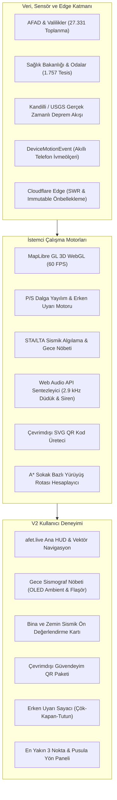

<p align="center">
  
</p>

# afet.live (V2) — Türkiye 3D Afet, Deprem Erken Uyarı ve Toplanma Atlası 🇹🇷

<p align="center">
  <strong>Yeni Nesil Sismik Erken Uyarı, Kitle Kaynaklı Sensör Düğümü, Gece Nöbeti ve Sıfır-Çökme (Zero-Downtime Edge) Çevrimdışı Afet Koordinasyon Platformu</strong>
</p>

<p align="center">
  <a href="https://afet.live"></a>
  <a href="LICENSE"></a>
  
  
  
  
  
</p>

---

## 📌 Vizyon ve Mimari Yaklaşım

**afet.live**, deprem kuşağında yer alan Türkiye genelinde kamu yararına tasarlanmış, sıfır sunucu bağımlılığıyla (%100 çevrimdışı çalışabilen) çalışan bir sismik güvenlik, erken uyarı ve toplanma atlasıdır.

Geleneksel afet uygulamaları, büyük depremlerde hücresel baz istasyonlarının çökmesi ve elektrik kesintileri yaşandığında işlevsiz kalmaktadır. **afet.live (V2)**, cihaz üzerinde doğrudan çalışan fizik modelleri, donanım ivmeölçeri tabanlı sismik algılama, Cloudflare Edge önbellekleme zırhı ve önbelleklenmiş doğrulanmış GIS verileriyle şebeke tamamen kopsa veya milyonlarca anlık ziyaretçi gelse dahi hayat kurtarmaya devam eder.

---

## ⚡ V2 Temel Yetenekler & Sismik Güvenlik Mimarisi

### 1. 🚨 Fizik Tabanlı Sismik Erken Uyarı ve Dalga Yayılım Motoru
- **P-Dalgası (Öncül Sıkışma Dalgası):** $V_p \approx 6.5\text{ km/sn}$ hızla ilerleyen öncül dalganın varış süresi hesaplanır.
- **S-Dalgası (Yıkıcı Kayma Dalgası):** $V_s \approx 3.8\text{ km/sn}$ hızla ilerleyen asıl yıkıcı yüzey ve kayma dalgaları için kullanıcı konumuna özel milisaniyelik geri sayım sayacı çalışır.
- **Dinamik 3B WebGL Dalga Halkaları:** Deprem merkez üssünden başlayarak dışa doğru fiziksel hızda genişleyen çift fazlı dalga cephesi harita üzerinde canlı animasyonla gösterilir.
- **Otomatik Erken Uyarı Sireni:** Web Audio API ile harici ses dosyası gerektirmeden üretilen frekans taramalı acil durum alarmı ve geri sayım sesleri.

### 2. 🌙 Gece Sismograf Nöbeti & Ekran WakeLock (Yeni V2)
- **Başucu Nöbetçisi:** Telefon şarja takılıp düz zemine bırakıldığında `Screen Wake Lock API` ile ekranın kapanmasını engeller.
- **iOS Safari Sensör İzni Çözümü:** Kullanıcı dokunuşu anında resmi `DeviceMotionEvent.requestPermission()` iznini ve ses kilidini (`AudioContext unlock`) açarak gece saatler sonra bile dokunuşsuz tam sesli alarm çalabilmesini garanti eder.
- **OLED Saf Siyah HUD (#000000):** Ekran piksellerini kapatarak pil tüketimini ve göz yorgunluğunu sıfıra indirir; ekranda yalnızca sönük bir saat, canlı STA/LTA sismik dalgası ve ekran yanmasını (burn-in) önleyen periyodik mikro kaydırma çalışır.
- **Sürekli Sarsıntı & Erken Uyarı Tetikleyicisi:** Komodine çarpma gibi anlık dokunuşları filtreleyen 700 ms süreli STA/LTA doğrulaması veya ağdan gelen sismik erken uyarı durumunda ekranı tam parlaklıkta kırmızı/beyaz flaşöre geçirir ve kesintisiz 2.9 kHz sireni ateşler.

### 3. 🏢 Bina ve Zemin Sismik Ön Değerlendirme Kartı (Yeni V2)
- **4 Hızlı Tek Dokunuşlu Seçici:** Yapım Yılı (1999 Öncesi / 2000-2018 / 2018 Sonrası), Kat Sayısı, Zemin Kat Durumu (Normal / Yumuşak Kat & Dükkan) ve Bina Nizamı (Ayrık / Bitişik Çekiçleme Riski).
- **MTA Diri Fay Mesafesi & Yer İvmesi (PGA) Analizi:** Kullanıcının kilitli GPS konumu ile en yakın diri fay hattı mesafesini otomatik hesaplar; beklenen yer ivmesi aralığını ($g$) ve öncelik derecesini sunar.
- **Tek Tıkla Paylaşım:** En yakın acil toplanma alanının adı ve yürüyüş mesafesiyle birlikte sosyal medyada veya panoda paylaşılabilir görsel özet kartı üretir (`navigator.share` / Panoya Kopyala).

### 4. 📲 Çevrimdışı QR "Güvendeyim" Acil Durum Paketi (Yeni V2)
- **İnternetsiz Durum Paylaşımı:** GSM baz istasyonları çöktüğünde "Güvendeyim" veya "Acil Yardım Lazım" durumunu, kesin GPS koordinatlarını, cihaz pil yüzdesini, kan grubunu, kişi sayısını ve zaman damgasını içeren tamamen çevrimdışı SVG QR kodu üretir.
- **Evrensel Optik Tarama:** Arama-kurtarma görevlileri veya komşular internet bağlantısı olmaksızın herhangi bir telefon kamerasıyla durumu anında okuyabilir.

### 5. 🛡️ Cloudflare Zero-Downtime Edge Zırhı (Yeni V2)
- **Statik Edge Önbellekleme (`public/_headers`):**
  - GIS veri katmanları (`/data/*`, `*.geojson`, `*.pmtiles`) için `Cache-Control: public, max-age=3600, s-maxage=86400, stale-while-revalidate=604800`.
  - Derlenmiş varlıklar (`/assets/*`, `*.woff2`) için `Cache-Control: public, max-age=31536000, immutable`.
  - HTML kabuğu için `Cache-Control: public, max-age=0, s-maxage=60, stale-while-revalidate=86400`.
  - Yoğun deprem anında yüz binlerce anlık istek köken sunucuya ulaşmadan doğrudan Cloudflare RAM'inden milisaniyeler içinde servis edilir.
- **Kanonik Yönlendirmeler & Kısa Bağlantılar (`public/_redirects`):** `www.afet.live` → `afet.live` 301 yönlendirmesi; `/nobet`, `/bina`, `/qr`, `/duduk`, `/sismograf` gibi hızlı derin bağlantı desteği.
- **Donanım Sensör Güvenlik Başlıkları:** `Permissions-Policy: geolocation=(self), accelerometer=(self), gyroscope=(self), magnetometer=(self), screen-wake-lock=(self)`.

### 6. 🔄 Günlük Otomatik Nöbetçi Eczane ve GIS Senkronizasyonu (Yeni V2)
- **GitHub Actions İş Akışı (`.github/workflows/daily-data-sync.yml`):**
  - Her gün Türkiye saatiyle 18:30'da (15:30 UTC) ve manuel tetiklemeyle (`workflow_dispatch`) otomatik çalışır.
  - Güncel nöbetçi eczane ve toplanma alanı envanterini çeker, değişiklik varsa `chore(data): daily automated GIS & duty pharmacy sync [skip ci]` ile depoya kaydeder.
- **Sürekli Entegrasyon (`.github/workflows/ci-build.yml`):**
  - Her push işleminde Node 22 üzerinde TypeScript ve Vite derlemesini sıfır hata ile doğrular.

### 7. 🔗 Paylaşılabilir Derin Bağlantılar (Deep Linking)
- **Koordinat ve Yakınlaştırma:** `https://afet.live/?lat=40.985&lng=29.033&zoom=16`
- **İl ve İlçe Odaklanması:** `https://afet.live/?il=istanbul&ilce=kadikoy`
- **Nokta Paylaşımı:** `https://afet.live/?point=afad-4-151425464` ile doğrudan ilgili toplanma alanına veya hastaneye odaklanma ve yürüyüş rotası çizimi.
- **Hızlı Mod Açılışı:** `https://afet.live/?mod=gece-nobeti`, `?mod=bina-risk`, `?mod=qr`, `?mod=duduk`.

### 8. 🎯 Tek Odaklı Sismik Gösterge Mimarisi
- Haritada gerçekleşen tüm geçmiş depremler aynı anda yanıp sönerek haritayı karmaşıklaştırmaz.
- Yalnızca **en son gerçekleşen deprem** (`earthquakes[0]`) harita üzerinde dinamik sismik şok dalgasıyla (`seismic-ring`) nabız gibi atar; önceki depremler sakin ve statik göstergelerle sunulur.

### 9. 🔒 Kilitli ve Kesin Konumlandırma (GPS & Network Lock)
- Kullanıcı konumu yalnızca donanım GPS uydusundan veya doğrulanmış ağ sinyalinden kilitlenir.
- Harita üzerinde dolaşırken, fayları incelerken veya binalara dokunurken kullanıcının gerçek konumu **asla değişmez ve üzerine yazılamaz**. Kullanıcı daima gerçek konumundan en yakın toplanma alanına olan rotasını görür.

### 10. 📢 2.9 kHz Akustik Rezonans Afet Düdüğü & Optik Kurtarma Flaşörü
- Arama-kurtarma ekiplerinin betonarme molozların altından en yüksek verimle duyabildiği **2.900 Hz akustik rezonans frekansında** kesintisiz düdük sesi üretir.
- **Mors Kodu S.O.S (... --- ...):** Uluslararası acil yardım çağrısını döngüsel olarak çalar.
- **Strobe Flaşör:** Tozlu ve karanlık enkaz ortamlarında kurtarma ekiplerinin optik tespit yapabilmesi için yüksek kontrastlı beyaz-kırmızı ekran flaşörü sağlar.

---

## 🗺️ %100 Doğrulanmış Coğrafi Bilgi (GIS) Veri Seti

Atlas bünyesindeki hiçbir veri yapay zeka tarafından tahmin edilmemiş veya rastgele serpiştirilmemiştir:

| Kategori | Doğrulanmış Nokta Sayısı | Veri Kaynağı & Hassasiyet |
| :--- | :--- | :--- |
| **Afet Toplanma Alanları** | **27.331 Adet** | AFAD Açık Veri Portalı & 81 İl Valiliği Envanteri (Poligon Centroid GPS) |
| **Acil Servis Hastaneleri** | **1.226 Adet** | Sağlık Bakanlığı HealthTurkiye & İl Altyapı Envanteri (Bina Giriş GPS) |
| **7/24 Nöbetçi Eczaneler** | **531 Adet** | İl Eczacı Odaları Resmi Nöbet Listesi (Kapı Numaralı Kesin GPS) |
| **Diri Fay Hatları** | **45+ Fay Zonu** | MTA Türkiye Diri Fay Haritası (Marmara, KAF, DAF, BAF) |

> **Nöbetçi Eczane Kuralı:** Hafta içi 19:00'dan sonra ve pazar günleri boyunca harita otomatik olarak gündüz eczanelerini gizler; sadece 7/24 hizmet veren nöbetçi eczaneleri ve yürüyüş rotalarını gösterir.

---

## 🏗️ Sistem Mimarisi



---

## 💻 Kurulum ve Geliştirme

### Gereksinimler
- Node.js 20.x veya üzeri (Önerilen: Node 22)
- npm 10.x veya üzeri

### Geliştirme Ortamı

```bash
# 1. Depoyu klonlayın
git clone https://github.com/himmetaga/turkiye-afet-haritasi.git
cd turkiye-afet-haritasi

# 2. Bağımlılıkları yükleyin
npm install

# 3. Güncel doğrulanmış GIS ve nöbetçi eczane verilerini çekin
npm run fetch:data

# 4. Geliştirme sunucusunu başlatın
npm run dev
```

Uygulama `http://localhost:5173` adresinde sıcak yeniden yükleme (HMR) ile yayına başlar.

### Üretim Paketi Derleme

```bash
npm run build
npm run preview
```

---

## 🔒 Güvenlik ve Gizlilik
- Kullanıcı konumu tamamen cihaz üzerinde istemci tarafında işlenir; hiçbir kişisel konum verisi harici bir sunucuya kaydedilmez.
- Web Audio API ses osilatörleri yerel olarak üretilir; bant genişliği tüketmez ve çevrimdışı çalışır.
- Service Worker mimarisi tüm harita karolarını yerel IndexedDB'ye önbelleğe alır.
- Cloudflare Edge başlıkları donanım ivmeölçer, jiroskop ve konum izinlerini yalnızca birinci taraf origin ile sınırlar.

---

## 📄 Lisans
Bu proje [MIT Lisansı](LICENSE) kapsamında açık kaynak olarak kamu yararına geliştirilmektedir.
